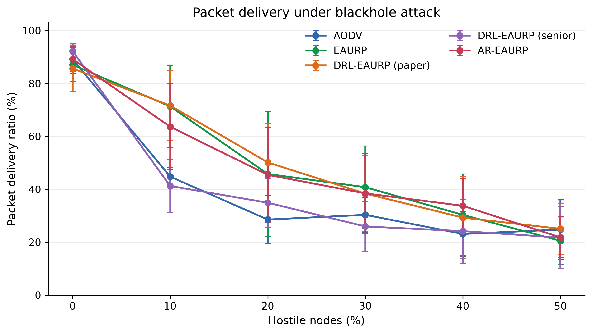
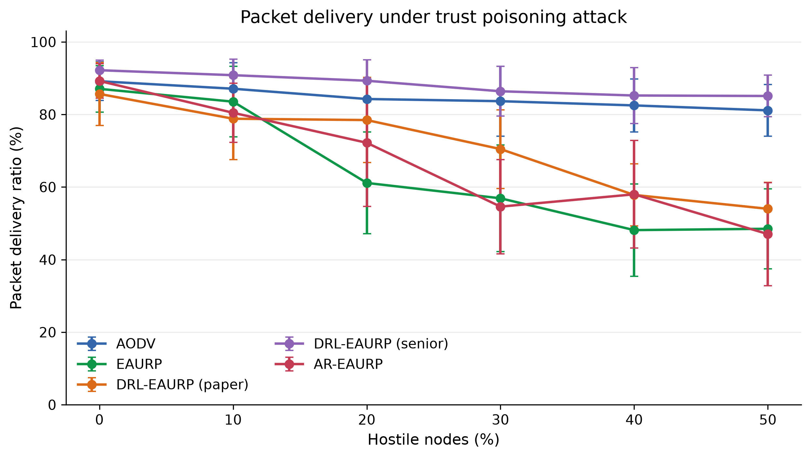

## Design, implementation, reproducible evaluation, and deployment boundaries

**Manuscript type:** research and systems paper  
**Repository:** `AR-EAURP-CN-Project`  
**Version:** 22 October 2026

**Status:** reproducible project manuscript; quantitative claims are limited to the artifacts and CSV checkpoints committed with the repository.

## Abstract

Mobile ad hoc networks (MANETs) combine three sources of instability: links change as nodes move, relays operate under finite or intermittent energy, and routing decisions are exposed to adversarial nodes. This project develops and evaluates AR-EAURP, an adversarial-resilient and energy-harvesting-aware extension of an energy- and trust-aware routing design. The work is deliberately structured as both a protocol implementation and an evaluation audit. It re-implements the equations of the source DRL-EAURP manuscript, preserves the delivered senior implementation for an as-is comparison, and adds a mechanistic routing harness in which packets traverse real multi-hop paths rather than being delivered by a single global coin flip.

AR-EAURP combines size-conditioned watchdog observations, a clean-trained GAN-style behaviour detector, harvested-energy forecasting with a persistence fallback, and a constrained deep-Q routing agent. Its threat model includes black holes, selective-forwarding gray holes, and trust poisoning. A Python common-harness evaluation and a separate native ns-3.45 study assess different models and are reported independently. In the ns-3 review matrix, 863 of 905 planned runs were completed across 179 of 181 conditions; the density sweep is incomplete. In the 24-node, six-flow attack experiment, detector performance at 30% gray-hole prevalence was modest (TPR 7.82% ± 4.98%, FPR 5.24% ± 5.14%, AUC 0.55 ± 0.07). Across 18 matched AR-EAURP–EAURP attack/prevalence contrasts, only one unadjusted 95% interval excluded zero. A separate 30-pair commissioning study estimated a +1.16 percentage-point PDR difference for AR-EAURP (95% paired CI −2.97 to +5.30), which is inconclusive. These results do not establish universal or statistically robust routing superiority. They show the importance of matching claims to the simulator, workload, completed replications and measured outcomes, and provide a reproducible evaluation pipeline for further study.

**Keywords:** mobile ad hoc networks, MANET security, trust-aware routing, gray-hole attack, energy harvesting, GAN anomaly detection, LSTM forecasting, constrained Markov decision process, deep Q-learning, reproducible simulation

---

## 1. Introduction

Mobile ad hoc networks are formed by wireless devices that communicate without fixed infrastructure. Their strengths—rapid deployment, self-organisation and operation without a central access point—also create a difficult routing environment. A route can fail because a node moves, a link fades, a relay exhausts its battery, or a relay deliberately drops traffic. A useful protocol must therefore balance connectivity, delivery performance, energy use and trust under partial information.

The project studied here, AR-EAURP, addresses that problem through a layered design. The starting point is EAURP, an energy- and trust-aware routing substrate. The project then adds three capabilities:

1. a threat model and detector intended to expose selective forwarding that hides behind a good aggregate forwarding ratio;
2. energy harvesting and short-horizon energy prediction, so route selection can distinguish a node that is currently weak but about to recharge from one that is weak and depleting; and
3. a constrained routing agent that chooses among route strategies while penalising violations of a target packet-delivery ratio.

The project contains more than a protocol sketch. It includes a vectorised Python simulator, a common comparison harness, a native re-implementation of the source equations, a preserved copy of the delivered senior logic, an ns-3 implementation with 802.11 packet paths, and a Flutter application named RelayMesh for direct nearby-device messaging. These artifacts serve different purposes and must not be conflated. The paper reports separate quantitative evaluations from the Python harness and the native ns-3 study; their scenarios and metrics are not pooled. RelayMesh is a deployment-facing direct-message application and is not a multi-hop evaluation of AR-EAURP.

### 1.1 Research questions

The evaluation is organised around five questions:

**RQ1 — Model validity.** What changes when paper-level probabilistic delivery is replaced by a hop-by-hop topology, channel, energy and adversary model?

**RQ2 — Selective forwarding.** Can size-conditioned observations detect a gray hole that remains above the scalar trust-revocation threshold?

**RQ3 — Component value.** What do the detector, energy forecaster and constrained agent contribute individually?

**RQ4 — Feasibility.** Is the requested 0.90 PDR floor reachable in the evaluated topology under attack?

**RQ5 — Cost.** What computational and control-plane overhead is introduced by the advancement?

### 1.2 Contributions

This paper makes four practical contributions:

- It gives a complete, code-grounded description of the AR-EAURP stack and its threat model.
- It separates native paper reproduction, fair Python common-harness comparison, and the ns-3.45 review matrix, preventing incomparable PDR values from being presented as one experiment.
- It reports stored results, ablations and failure cases—including an infeasible CMDP target and a forecast model that loses to a simple seasonal baseline.
- It documents the project boundary between the Python simulator, the ns-3 implementation and the RelayMesh application, enabling future work to choose the appropriate validation layer.

---

## 2. Background and related work

### 2.1 On-demand MANET routing

AODV is the reference routing baseline in this project. It discovers routes on demand and repairs or invalidates routes when links change. The IETF specification targets mobile ad hoc networks and explicitly reduces unnecessary control dissemination, but its trust model assumes that participating nodes can be trusted [1]. This makes AODV an appropriate connectivity baseline and an intentionally weak security baseline.

EAURP adds energy and trust signals to route selection. The implementation in `src/routing/` follows the repository's source description: a route score combines trust and residual energy, relays below 20% of initial energy are excluded, watchdog observations produce packet-forwarding ratios, and PT_NID, PT_GID and PT_CREV messages support neighbour reporting, consensus and revocation. The source paper is Chandra and Chakravarthy's 2025 EAURP article [2].

### 2.2 Reinforcement learning for routing

The DRL-EAURP line uses a state containing trust, energy and mobility and a Q-learning update. Deep Q-networks combine temporal-difference learning with a neural value function [3]. In the delivered senior model, however, the action offsets are fixed: action 0 adds 0.08 to the base delivery probability and action 1 adds 0.02. Consequently, action 0 is strictly preferred in every state. The project retains this logic for provenance while also implementing the paper model independently, making its degeneracy measurable rather than silently “improving” it.

### 2.3 GAN-based anomaly detection

GANs learn a data distribution through a generator-discriminator game [4]. AnoGAN-style detection uses the distance between an observation and the learned normal manifold as an anomaly signal [5]. AR-EAURP applies that idea to watchdog feature vectors rather than images. It trains on clean behaviour windows, freezes the detector before attacked evaluation, and uses a generated sample bank for fast nearest-manifold scoring. The implementation also records the discriminator score separately. This matters because a discriminator trained to distinguish real from generated data is not automatically a detector of malicious-but-real behaviour.

### 2.4 Temporal energy prediction

LSTM networks were designed to preserve useful gradients across long temporal intervals [6]. AR-EAURP uses a small LSTM to estimate cumulative harvest over the next ten simulation rounds from recent harvest, battery and time-of-day features. The evaluation compares it with persistence and seasonal-naive baselines because forecasting a synthetic diurnal signal can make a simple periodic baseline unusually strong.

### 2.5 Constrained decision-making and energy harvesting

Constrained Markov decision processes (CMDPs) formalise sequential decisions subject to resource or safety constraints [7]. AR-EAURP uses a Lagrangian dual variable to penalise a rolling PDR gap. Energy harvesting is modelled as a diurnal solar process with cloud persistence and a small kinetic contribution. Energy-harvesting wireless sensor network research commonly treats prediction and energy management as first-class routing concerns [8]; this project evaluates whether the particular LSTM component earns that complexity in the chosen workload.

### 2.6 Competitive positioning

Recent work raises the standard beyond reporting a single PDR curve. A 2025 DRL-MANET study combines deep Q-learning, residual energy, trust, link quality and anomaly detection, and evaluates routing security and QoS together [11]. A 2025 MASS paper addresses RL instability with an expert-initialised, conservative policy and reports worst-case behaviour in addition to average performance [12]. A 2024 secure-routing study instead provides a protocol-level guarantee against fabricated, compromised or replayed route replies under an explicit security association assumption [13]. Recent work also increasingly uses graph-aware or topology-aware learning rather than a fixed global state [14].

These papers are not direct numerical baselines for this project: they use different mobility, traffic, threat, channel and simulator assumptions. They are nevertheless useful competitive references because they define expectations for (i) comparable baselines, (ii) explicit attack and trust assumptions, (iii) variance or worst-case reporting, (iv) ablations against simpler alternatives, and (v) a clear separation between empirical robustness and formal security guarantees. The current evidence supports code-grounded auditability, but native ns-3 detection remains weak and the delivery comparisons are inconclusive. The project does not establish formal guarantees, graph-scale learning, radio-calibrated validation or superiority to these systems.

---

## 3. Project architecture and scope

The repository is organised into four functional layers.

| Layer | Main artifacts | Role in this paper |
|---|---|---|
| Common Python harness | `src/common/`, `src/routing/`, `experiments/` | Historical Python comparison and the earlier Colab-review result; reported separately from ns-3 |
| Native implementations | `src/a_drl_eaurp/`, `src/b_senior/`, `src/c_ar_eaurp/` | Paper reproduction and advancement comparison |
| ns-3 implementation | `ns3/contrib/ar-eaurp/`, `ns3/scratch/` | Native C++ packet/radio evaluation reported separately in Track 3 |
| RelayMesh application | `app/` | Direct nearby-device Flutter messenger; deployment-facing artifact, not a MANET protocol benchmark |

The ns-3 implementation uses an IPv4 stack, 802.11 ad hoc radios, log-distance path loss, Nakagami fading, mobility, UDP flows, energy sources and a solar harvester. Its protocol class exposes AODV, EAURP and DRL/AR-EAURP variants through a shared simulation harness. The Flutter app uses Wi-Fi Direct for Android-to-Android communication and Multipeer Connectivity for Apple-to-Apple communication. Android and Apple transports are currently separate, and Chrome is a UI preview rather than a nearby-radio test.

The system boundary is important: a direct phone-to-phone chat is not evidence of multi-hop AR-EAURP routing, and a Python channel model is not evidence of radio realism. Each artifact is reported for what it actually validates.

---

## 4. Protocol design

This section describes the protocol design and the legacy Python experiment model. Python-specific geometry and channel assumptions are explicitly identified; native ns-3 configuration is specified in Section 5 and should be used when interpreting the current results.

### 4.1 Legacy Python common-harness model

The common harness deploys (N) nodes in a 1000 m × 1000 m square. Nodes move toward randomly selected destinations. A link exists when the Euclidean distance is at most 150 m:

$$
 A_{ij}(t) = \mathbf{1}[d_{ij}(t) \leq R], \qquad R=150\text{ m}.
$$

The source papers do not define a physical layer or per-hop link model. The harness therefore makes that assumption explicit. For a hop between nodes (i) and (j), reliability is

$$
 p_{ij} = \operatorname{clip}\left(
 0.995 - 0.02\frac{d_{ij}}{R} - 0.03\frac{\max(v_i,v_j)}{v_{\max}},
 0.90, 1.0\right).
$$

This is not inherited from the papers. It is calibrated so that clean-network results remain in the same broad delivery regime while preserving a meaningful cost for long paths and high mobility. Delay is accumulated hop by hop as

$$
 D = D_{base} + \sum_{h=1}^{H}D_{hop,h},
$$

with $D_{base}\sim U(20,50)$ ms and $D_{hop}\sim U(4,10)$ ms.

Traffic uses 40 persistent source-destination flows. Each round offers four packets with sizes uniformly sampled from 512 to 1024 bytes. Packets are walked through the selected path. At every hop, the link can fail, a node can be dead or revoked, or an adversarial relay can drop the packet. The predecessor records whether a relay forwarded the packet, creating a concrete watchdog observation.

### 4.2 EAURP trust and route scoring

For observer (i) and subject (j), the watchdog packet-forwarding ratio is

$$
 \operatorname{PFR}_{ij} = \frac{F_{ij}}{S_{ij}},
$$

where (S_{ij}) is the number of packets handed to (j) and (F_{ij}) is the number subsequently overheard as forwarded. The smoothed trust update is

$$
 T_{ij}(t+1)=0.7T_{ij}(t)+0.3\operatorname{PFR}_{ij}(t).
$$

The EAURP score combines network trust and normalised energy:

$$
 R_i = aT_i+bE_i,
 \qquad
 b=\frac{\overline{E}}{E_{max}},
 \qquad
 a=1-b.
$$

The repository preserves the source coefficient definition but uses a cost formulation for route search, because maximising a cumulative non-negative score would otherwise reward longer paths. The practical cost is

$$
 c_i=(1-R_i)+\lambda_h,
$$

where (lambda_h=0.35) is a per-hop penalty. Relays are eligible only when alive, not revoked and above 20% of initial energy.

Every ten rounds, PT_NID updates trust observations. Every 25 rounds, PT_GID collects accusations and applies a majority threshold with at least two accusers. PT_CREV then propagates revocations. An energy excuse prevents a flat battery from being treated as malicious solely because it failed to forward.

### 4.3 Adversary model

The threat model is intentionally operational rather than merely descriptive.

**Black hole.** A black hole advertises a perfect route and drops all data packets while continuing to relay control traffic. This tests whether trust can recover from a route-selection lie.

**Gray hole.** A gray hole relays control and small packets but drops large packets with probability 0.25. The large-packet threshold is 700 bytes. Given the 512–1024 byte traffic distribution, the aggregate loss is approximately 15%, leaving the scalar observed PFR near 0.84—above the 0.60 revocation threshold.

**Trust poisoning.** A trust-poisoning node is a gray hole that also lies in PT_GID reports: it assigns trust 1.0 to colluding attackers and 0.15 to selected honest nodes. This attacks the consensus layer rather than only the data plane.

### 4.4 AR-EAURP detector

The detector uses eight features computed over recent watchdog windows:

$$
 x = [\operatorname{PFR}_{short},\operatorname{PFR}_{long},
 \Delta\operatorname{PFR},d_{large},d_{small},
 \mu_{lat},\sigma_{lat},\delta_{report}].
$$

The central signal is the difference between large- and small-packet forwarding behaviour. The final feature measures disagreement between one observer's published trust and the median of other observers, exposing slander even when the data-plane PFR looks normal.

The GAN is trained only on clean commissioning windows. Clean features are standardised with a minimum standard-deviation floor of 0.02. This is a deliberate design choice: honest large-packet drop can have zero variance, so replacing a zero standard deviation with 1.0 would erase the very signal that identifies a gray hole. The anomaly score is dominated by the distance to a fixed generated bank:

$$
 s(x)=\min_{z\in\mathcal{B}}\left\|\widetilde{x}-G(z)\right\|,
$$

with a monotone squashing into ([0,1)). A node becomes contested when its mean score across observers exceeds the 95th percentile of clean scores. The contested state lasts for 50 rounds and halves the node's trust weight.

The order of operations is security-critical. A black hole's false route advertisement can overwrite an ordinary trust score. AR-EAURP therefore applies the contested down-weight after route-score construction, so the detector can suppress a malicious perfect advertisement.

### 4.5 Energy harvesting and forecasting

The linear model follows the source-style depletion process:

$$
 E_i(t+1)=E_i(t)-d_i(t), \qquad d_i(t)\sim U(0.04,0.12).
$$

The harvesting model adds solar and kinetic gain:

$$
 E_i(t+1)=\operatorname{clip}(E_i(t)-d_i(t)+H_i(t),0,E_{max}),
$$

where $H_i(t)$ is a diurnal solar term for 70% of nodes, modulated by an AR(1) cloud process, plus a small speed-proportional kinetic term. The LSTM receives recent harvest, normalised energy and sine/cosine time-of-day features and predicts cumulative harvest over the next ten rounds. The predicted surplus is blended with present energy for the energy-aware route score.

### 4.6 CMDP routing agent

The routing agent state has six components:

$$
 s_t=[\overline{T}_{robust},\overline{E},\overline{M},
 \overline{H}_{pred},\rho_{contested},\operatorname{PDR}_{window}].
$$

The four actions select trust-led, predicted-energy-led, balanced EAURP, or diversified routing. The reward is

$$
 r_t=r_{delivery}-0.05c_{energy}
 -\lambda_t\max(0,\tau-\operatorname{PDR}_{window})C,
$$

where $\tau=0.90$, $C=5$, and the dual variable is updated by

$$
 \lambda_{t+1}=\operatorname{clip}\left(
 \lambda_t+0.05(\tau-\operatorname{PDR}_{window}),0,20\right).
$$

The implementation uses a DQN with replay and a target network when PyTorch is available, with a tabular fallback otherwise. The fallback is explicit in result metadata.

---

## 5. Experimental methodology

### 5.1 Evaluation stages and evidence scope

This paper distinguishes three evidence sources. The earlier Python/Colab review is retained as historical context because it used a different simulator and model. The current primary evaluation is a native C++ implementation in ns-3.45. A separate 30-pair ns-3 study evaluates a later CMDP commissioning change. Outcomes from these stages are not pooled: topology, packet and radio models, commissioning, run numbers, observation windows, and detector instrumentation differ.

The earlier Python full-profile gray-hole result presented during the Colab review at 30% hostile nodes reported PDR 50.25% ± 5.86% for AR-EAURP and 47.92% ± 5.24% for EAURP (five runs), a descriptive difference of +2.32 percentage points. The earlier analysis also reported detector TPR of 29.3% ± 9.2% and FPR of 1.4% ± 1.3% for AR-EAURP. These are historical Python-harness results, not ns-3 measurements. They are included to document what was presented at the previous review; they are not evidence that the native ns-3 implementation has the same performance.

### 5.2 Native ns-3.45 configuration

The E1–E6 review matrix used a 24-node, six-flow review scenario over a 420 m square area, with 120 s of measured simulation, 20 s warm-up and 10 s cooldown. Each CBR flow generated one packet/s; packet sizes were uniformly sampled between 512 and 1024 bytes. Nodes began with 350 J, used a 1–20 m/s mobility range, and had a 150 m routing-neighbour range. The radio used 16.0206 dBm transmit power, −96 dBm receiver sensitivity and a path-loss exponent of 3.0. Harvesting was enabled by default. AR-EAURP received 240 s of clean commissioning; GAN and LSTM training budgets were 120 and 30 epochs respectively. The master seed was 20260909 and five run numbers were planned for each condition.

The ns-3 implementation uses an IPv4 and 802.11 ad hoc stack, scheduled packet events, routing and queue behaviour, energy sources and harvesting. This is a simulated radio environment, not a physical testbed or calibrated field measurement. A separate CMDP commissioning study used a 24-node, six-flow, 420 m topology, 25% gray-hole prevalence, 120 s measured window, 20 s warm-up, seed 1 and matched run numbers 21–50. It trained the CMDP selector in a separate clean commissioning phase before attacked evaluation.

### 5.3 Experiment matrix

| Experiment | Factors varied | Planned conditions | Planned runs |
|---|---|---:|---:|
| E1 mobility | Five protocols × 1, 5, 10, 15, 20 m/s | 25 | 125 |
| E2 density | Five protocols × 60, 80, 100, 120, 150, 200 nodes | 30 | 150 |
| E3 attacks | Five protocols × three attacks × 0–50% hostile nodes in 10-point steps | 90 | 450 |
| E4 energy | Five protocols × battery or solar/kinetic harvesting | 10 | 50 |
| E4b lifetime | Five protocols × battery or harvesting, 900 s horizon | 10 | 50 |
| E5 ablation | Six AR-EAURP component variants | 6 | 30 |
| E5b CMDP floor | Requested PDR floors 0.70, 0.80, 0.90, 0.95 | 4 | 20 |
| E6 overhead | Five protocols plus AR-EAURP without ECC | 6 | 30 |

The protocol set is AODV, EAURP, paper DRL-EAURP, senior-code DRL-EAURP and AR-EAURP. Attacks are black hole, gray hole and trust poisoning. Each experiment condition has its own factor settings and is listed in the committed configuration ledger.

### 5.4 Metrics and statistical analysis

PDR is application packets received divided by application packets sent in the measurement window, including arrivals during cooldown. Delay and throughput are application-level measurements. E3 detector TPR, FPR and AUC refer to AR-EAURP's per-window anomaly score; they are not available for baseline protocols that do not implement this detector. The report separately records contested-node and revocation outcomes so a detector alert is not conflated with consensus or action.

For replicated conditions, the report presents arithmetic means and sample standard deviations across observed run numbers. Per-condition 95% confidence intervals use a two-sided Student t interval and are omitted for n=1. Bounded rate intervals are restricted to [0,1]. E3 paired comparisons use matching run numbers for AR-EAURP and EAURP. Their intervals are unadjusted across 18 attack/prevalence cells and therefore exploratory. Matching run numbers does not guarantee event-level identical random draws because protocol actions can consume random streams differently.

### 5.5 Reproducibility and result provenance

The native review report records the simulator version and source identity, configuration factors, exact per-run command-line parameters, seed/run numbers, simulator-reported settings, raw checkpoint checksums, CSV summaries, figures and completion status. The separate CMDP commissioning study stores its JSON outputs and native simulator logs. Results below are extracted from those saved artifacts; incomplete runs are not imputed.

---

## 6. Results

### 6.1 Completion of the native evaluation

The E1–E6 matrix completed 179 of 181 planned conditions and 863 of 905 planned native runs. E1, E3, E4, E4b, E5, E5b and E6 completed their planned run counts. E2 completed 28 of 30 conditions and 108 of 150 runs. High-density conditions include single-run observations, and two planned conditions are absent. The partial density sweep cannot support replicated inference at those node counts.

| Experiment | Completed conditions | Completed runs | Status |
|---|---:|---:|---|
| E1 mobility | 25/25 | 125/125 | Complete |
| E2 density | 28/30 | 108/150 | Partial; no imputation |
| E3 attacks | 90/90 | 450/450 | Complete |
| E4 energy | 10/10 | 50/50 | Complete |
| E4b lifetime | 10/10 | 50/50 | Complete |
| E5 ablation | 6/6 | 30/30 | Complete |
| E5b CMDP floor | 4/4 | 20/20 | Complete |
| E6 overhead | 6/6 | 30/30 | Complete |

### 6.2 Mobility and density

AR-EAURP did not dominate the mobility comparison at every speed. Its PDR was higher than EAURP at 20 m/s, while EAURP was higher at the other four tested speeds. The observed means and sample standard deviations are:

| Maximum speed | EAURP PDR (%) | AR-EAURP PDR (%) |
|---:|---:|---:|
| 1 m/s | 86.80 ± 9.64 | 86.60 ± 14.32 |
| 5 m/s | 95.00 ± 4.99 | 94.10 ± 5.56 |
| 10 m/s | 88.10 ± 7.01 | 83.93 ± 11.10 |
| 15 m/s | 88.90 ± 6.38 | 86.17 ± 6.90 |
| 20 m/s | 87.07 ± 6.41 | 89.23 ± 4.73 |

The density results are mixed. Across replicated conditions from 60 to 120 nodes, AR-EAURP PDR was 92.40%, 88.00%, 67.87% and 60.70%; EAURP PDR was 89.47%, 87.03%, 70.00% and 65.50%. These are descriptive comparisons rather than evidence of a stable ordering. At 150 nodes all protocols have only one completed run; at 200 nodes coverage is incomplete and one-run cells are descriptive only. Density-specific claims should be deferred until the missing replications are run.


### 6.3 Attack resilience and detection

The E3 attack sweep varied black-hole, gray-hole and trust-poisoning prevalence from 0% to 50%. At 30% hostile nodes, the five-protocol PDR comparison was:

| Protocol | Black hole PDR (%) | Gray hole PDR (%) | Trust poisoning PDR (%) |
|---|---:|---:|---:|
| AODV | 30.37 ± 6.55 | 83.67 ± 9.62 | 83.67 ± 9.62 |
| EAURP | 40.80 ± 15.61 | 82.67 ± 2.84 | 56.90 ± 14.72 |
| DRL-EAURP (paper) | 38.40 ± 14.38 | 82.60 ± 10.65 | 70.47 ± 10.84 |
| DRL-EAURP (senior) | 25.97 ± 9.38 | 86.40 ± 6.85 | 86.40 ± 6.85 |
| AR-EAURP | 38.47 ± 15.13 | 83.90 ± 8.08 | 54.60 ± 12.97 |

For the 30% gray-hole condition, AR-EAURP's per-window detector had TPR 7.82% ± 4.98%, FPR 5.24% ± 5.14%, and AUC 0.55 ± 0.07 across five runs. This is weak discrimination in this native workload and is notably lower than the historical Python-harness result. The Python detector result must not be transferred to ns-3 as though it were the same experiment.

Across all 18 attack/prevalence cells, five matched run numbers were used for paired AR-EAURP minus EAURP PDR comparisons. Only one unadjusted 95% interval excluded zero: trust poisoning at 20% prevalence, +11.07 percentage points (95% CI +1.35 to +20.79; AR-EAURP won all five pairs). At 30% gray-hole prevalence, the paired difference was +1.23 points (95% CI −9.06 to +11.53; two of five pairs favored AR-EAURP). Since the contrast family is exploratory and unadjusted, the isolated trust-poisoning result is hypothesis-generating and does not establish general superiority.






### 6.4 Energy, lifetime and component ablations

With battery-only operation, AR-EAURP's E4 PDR was 87.47% ± 4.41%; with solar/kinetic harvesting it was 89.23% ± 4.73%. The harvest model increased residual energy, but these results do not by themselves show a statistically resolved PDR gain. In the 900 s lifetime experiment, first node death occurred at 423.60 ± 0.69 s on battery and 432.79 ± 1.90 s with harvesting. The 80%-dead endpoint was censored in the harvested runs, which means it was not observed within the configured horizon and must not be treated as an observed death time.

The E5 ablation gives a clearer result about the detector component. Removing GAN detection eliminated the reported TPR in this experiment but did not reduce PDR; the no-GAN variant's PDR was 85.63% ± 8.04% versus 83.90% ± 8.08% for the full system. LSTM and CMDP ablations produced small, mixed changes. This supports that the detector component creates the measured anomaly signal, while the current data do not show that it improves delivery.

| AR-EAURP variant | PDR (%) | Window TPR (%) | Window FPR (%) | Score AUC |
|---|---:|---:|---:|---:|
| Full | 83.90 ± 8.08 | 7.82 ± 4.98 | 5.24 ± 5.14 | 0.55 ± 0.07 |
| Without GAN | 85.63 ± 8.04 | 0.00 ± 0.00 | 0.00 ± 0.00 | 0.50 ± 0.00 |
| Without LSTM | 83.97 ± 7.25 | 8.89 ± 8.43 | 5.92 ± 3.67 | 0.56 ± 0.03 |
| Without CMDP | 84.50 ± 7.35 | 6.77 ± 8.57 | 5.55 ± 5.21 | 0.60 ± 0.09 |
| Bare AR-EAURP | 82.67 ± 2.84 | 0.00 ± 0.00 | 0.00 ± 0.00 | 0.50 ± 0.00 |
| Without energy excuse | 83.90 ± 8.08 | 7.82 ± 4.98 | 5.24 ± 5.14 | 0.55 ± 0.07 |


### 6.5 CMDP delivery floor and security overhead

In E5b, raising the requested raw-PDR floor did not yield a monotonic increase in observed PDR. The mean was 88.63% ± 4.07% at a 0.80 floor, 83.90% ± 8.08% at 0.90 and 78.20% ± 12.22% at 0.95. The evaluated scenarios do not demonstrate that AR-EAURP meets the 0.90 constraint. A requested constraint is a target, not a guarantee; the observed result indicates that this formulation and workload do not reliably satisfy it.

In E6 at 30% gray-hole prevalence, AR-EAURP reported 218,395 ± 14,431 control bytes, 30,906 ± 1,356 cryptographic bytes and mean delay 0.28 ± 0.14 s. EAURP reported 224,339 ± 10,551 control bytes, 30,654 ± 495 cryptographic bytes and 0.27 ± 0.08 s delay. The no-ECC ablation reported zero cryptographic bytes, with higher mean control bytes (230,748 ± 24,774). These are simulator accounting metrics for the configured scenario; they should not be generalized to deployed network cost without calibration.

### 6.6 Earlier native five-run comparison

A separate, earlier native ns-3 validation used runs 1–5 with seed 1 at 25% gray-hole prevalence. EAURP PDR was 83.73% ± 4.23%, compared with 81.83% ± 4.60% for AR-EAURP. The paired AR-EAURP minus EAURP estimate was −1.90 percentage points (95% CI −8.46 to +4.66), which is inconclusive. The AR detector's AUC was 0.55 ± 0.08, contested-node TPR was 0%, and the LSTM lost to persistence on every commissioning evaluation. This earlier result is preserved because it motivated subsequent implementation corrections, but it is a separate configuration and should not be pooled with the E1–E6 matrix.

### 6.7 CMDP commissioning follow-up

A later study trained the CMDP route selector during clean commissioning and evaluated 30 matched run numbers (21–50) under 25% gray-hole prevalence. EAURP mean PDR was 79.81%; AR-EAURP mean PDR was 80.97%. The paired difference was +1.16 percentage points (95% CI −2.97 to +5.30), with AR-EAURP winning 16 of 30 pairs. Mean delay was 0.256 s for EAURP and 0.288 s for AR-EAURP; the paired delay difference was +32 ms (95% CI −21 to +84). AR-EAURP's detector TPR was 4.69%, FPR 4.94%, and AUC 0.586.

The point estimate is slightly positive, but both PDR and delay intervals include zero. This follow-up therefore does not establish that commissioning-trained CMDP improves delivery. Earlier greedy and low-exploration tuning candidates are retained in the repository but are not used as confirmatory evidence; the greedy candidate performed worse than EAURP on its ten held-out pairs. Selection and held-out run ranges are documented in the optimization-study README.

### 6.8 Comparison with the prior Colab review

The previous project review reported a modest AR-EAURP advantage in the Python evaluation presented in Colab. The stored Python full-profile gray-hole result at 30% prevalence was 50.25% ± 5.86% PDR for AR-EAURP and 47.92% ± 5.24% for EAURP. Under that model, the point difference was positive. The current native ns-3 results do not reproduce that numerical PDR level: the 30% gray-hole PDRs are 83.90% for AR-EAURP and 82.67% for EAURP in the separate ns-3 review scenario. The numerical values are not directly comparable because traffic volume, topology, channel, routing events, energy, measurement and protocol implementations differ. Within ns-3, the 5-run attack matrix and the 30-pair CMDP follow-up both have confidence intervals spanning zero for the main gray-hole PDR contrast. The defensible conclusion is that the earlier Python result motivated a native evaluation, but native ns-3 evidence so far does not confirm a reliable delivery advantage.

### 6.9 Figures and machine-readable evidence

The expanded ns-3 report includes full tables for E1–E6, per-run settings, aggregate settings, paired attack comparisons, figures and raw checkpoints. The optimization-study folder contains the 30-pair follow-up JSON and logs. Together these artifacts provide the detailed result record behind this concise manuscript; incomplete density runs remain explicitly absent.

---

## 7. Discussion

The current evidence shows that protocol performance depends on the simulator and workload. The earlier Python/Colab review reported a positive PDR point estimate for AR-EAURP in one gray-hole condition. Native ns-3 measured a small positive difference in the 30% gray-hole review cell, but the five-run paired interval was wide and included zero. A separate 30-pair commissioning-trained CMDP study also had a positive point estimate, but its confidence interval included zero. These results are consistent with a possible benefit, but are not sufficient to claim that AR-EAURP is better than EAURP in delivery performance.

The current ns-3 detector result is also less favorable than the earlier Python result. At 30% gray-hole prevalence, the per-window AUC of 0.55 indicates weak ranking ability under this native implementation and review workload. The ablation shows that the GAN contributes the measured alert signal, but does not show that the detector improves packet delivery. Improving detector calibration, observation coverage and validation against simpler detectors is a priority before claiming operational attack detection.

The density and CMDP studies reinforce the same conclusion. High-density measurements are incomplete, and single-run conditions cannot establish a trend. The requested 0.90 raw-PDR floor was not reached reliably. Results should therefore be presented as a measured performance envelope with uncertainty rather than as a guarantee or universal protocol ranking.

The project's contribution at this stage is the end-to-end implementation, transparent experiment record, attack-specific analysis, ablations and explicit correction of earlier overclaims. The current evidence is useful because it identifies both the potential and the unresolved limits of the protocol.

---

## 8. Limitations and threats to validity

1. **Incomplete density matrix.** The native E2 sweep completed 108/150 runs. Two conditions are absent, and several high-density observations have n=1. No inference is made from these as replicated results.
2. **Simulator fidelity.** ns-3 provides a modeled IPv4/802.11 environment, not calibrated over-the-air measurements. Hardware validation remains future work.
3. **Different experiment tracks.** Python/Colab and ns-3 use different workloads, channel, routing and observation implementations. Their raw PDR values cannot be compared as a controlled treatment effect.
4. **Weak native detector performance.** The measured AUC was 0.55 in the selected 30% gray-hole review condition; TPR and FPR are window-level metrics. These do not establish high-confidence detection or successful network-wide consensus.
5. **Multiple comparisons.** E3 contains 18 exploratory paired attack/prevalence contrasts. The reported intervals are not adjusted for this family; the sole interval excluding zero requires independent confirmation.
6. **Limited run counts.** Most E1–E6 conditions have five runs. Five replications can leave wide intervals for noisy effects; the separate 30-pair study is more informative but still has intervals spanning zero for its primary PDR and delay outcomes.
7. **CMDP feasibility.** The raw-PDR target may be mismatched to reachable traffic and topology. An unmet target is not proof that no policy can satisfy a better-formulated constraint.
8. **Energy model assumptions.** Battery, radio-current and harvest parameters are simulator settings. Lifetime values are comparative outputs under those settings, not real device lifetime predictions.
9. **Threat coverage.** The evaluation covers black holes, gray holes and trust poisoning. Sybil identities, wormholes, adaptive selective forwarding, collusion and MAC-layer attacks require additional tests.
10. **Forecast and detector baselines.** The LSTM was rejected in an earlier commissioning evaluation when it failed to beat persistence. More independent detector and forecaster baselines are required before attributing gains to complex models.
11. **External validity.** The results do not establish superiority over all MANET protocols, all attack mixes or published systems with incompatible workloads.

---

## 9. Reproducibility and future work

The current native review report and study outputs are committed with the project. In the configured WSL environment, build and verify ns-3.45, then run the matrix with:

```bash
bash ns3/scripts/setup.sh
bash ns3/scripts/run.sh --verify=1
bash ns3/scripts/run.sh --profile=review --only=e1,e2,e3,e4,e5,e6 --out=results/ns3-native-paper-review --render=0
```

The CMDP commissioning follow-up can be reproduced with:

```bash
bash ns3/scripts/run_cmdp_commissioning_study.sh results/optimization_study/reproduction 21 50
```

The study ledgers record settings and source hashes. The remaining 42 E2 replications are required to complete the originally planned matrix. Re-running that work should preserve the fixed seed and exact run numbers, verify that existing checkpoints match their hashes, and regenerate the aggregate tables and figures without imputing missing runs.

Future work should prioritize: (i) finishing E2 and adding replications where confidence intervals remain broad; (ii) improving the ns-3 detector and comparing it with simple one-class baselines; (iii) defining a reachable-traffic or topology-conditioned CMDP constraint; (iv) pre-registering a confirmatory gray-hole comparison and adjusting for multiple hypotheses; and (v) validating radio and energy assumptions against a hardware testbed.

---

## 10. Conclusion

The current native ns-3 evidence does not prove that AR-EAURP outperforms EAURP. In the completed attack matrix, only one of 18 unadjusted paired PDR intervals excluded zero, and that trust-poisoning result requires confirmation. The 30-pair commissioning-trained CMDP study estimated a +1.16 percentage-point delivery difference, but its 95% interval ranged from −2.97 to +5.30 points. At 30% gray-hole prevalence, the ns-3 detector achieved TPR 7.82%, FPR 5.24% and AUC 0.55, which is weak performance in the tested scenario. The density sweep remains incomplete at 863/905 total runs.

The earlier Python/Colab review reported a modest positive PDR difference in a distinct gray-hole experiment. That result motivated the native evaluation, but it cannot be transferred to ns-3 or treated as a direct comparison. The project's strongest current contribution is a transparent, reproducible implementation and evidence pipeline that records where AR-EAURP may help and where further engineering and statistically powered validation are still needed.

---


## References

[1] C. Perkins, E. Belding-Royer, and S. Das, “Ad hoc On-Demand Distance Vector (AODV) Routing,” IETF RFC 3561, 2003. [https://www.rfc-editor.org/rfc/rfc3561](https://www.rfc-editor.org/rfc/rfc3561)

[2] A. Chandra and A. S. N. Chakravarthy, “EAURP: An Energy-Efficient and Trust-Aware Unobservable Routing Protocol for Secure Mobile Ad Hoc Networks,” *Sustainable Computing: Informatics and Systems*, 2025. DOI: [10.1016/j.suscom.2025.101285](https://doi.org/10.1016/j.suscom.2025.101285)

[3] V. Mnih et al., “Human-level control through deep reinforcement learning,” *Nature*, vol. 518, pp. 529–533, 2015. DOI: [10.1038/nature14236](https://doi.org/10.1038/nature14236)

[4] I. Goodfellow et al., “Generative Adversarial Nets,” *Advances in Neural Information Processing Systems 27*, 2014. [https://papers.neurips.cc/paper/5423-generative-adversarial-nets](https://papers.neurips.cc/paper/5423-generative-adversarial-nets)

[5] T. Schlegl et al., “Unsupervised Anomaly Detection with Generative Adversarial Networks to Guide Marker Discovery,” arXiv:1703.05921, 2017. [https://arxiv.org/abs/1703.05921](https://arxiv.org/abs/1703.05921)

[6] S. Hochreiter and J. Schmidhuber, “Long Short-Term Memory,” *Neural Computation*, vol. 9, no. 8, pp. 1735–1780, 1997. DOI: [10.1162/neco.1997.9.8.1735](https://doi.org/10.1162/neco.1997.9.8.1735)

[7] E. Altman, *Constrained Markov Decision Processes*, CRC Press, 1999. [Publisher record](https://books.google.com/books/about/Constrained_Markov_Decision_Processes.html?id=3X9S1NM2iOgC)

[8] F. K. Shaikh and S. Zeadally, “Energy harvesting in wireless sensor networks: A comprehensive review,” *Renewable and Sustainable Energy Reviews*, vol. 55, pp. 1041–1054, 2016. DOI: [10.1016/j.rser.2015.11.010](https://doi.org/10.1016/j.rser.2015.11.010)

[9] L. S., “DRL-EAURP,” unpublished manuscript, Vellore Institute of Technology. The repository re-implementation is documented in `src/a_drl_eaurp/` and `project_docs/README.md`.

[10] AR-EAURP project artifacts: `src/`, `experiments/`, `ns3/`, `app/`, `results/` and the internal advancement roadmap `project_docs/Date_ 24_07_26.docx`.

[11] “Deep Reinforcement Learning-based Mobile Ad Hoc Network for Secure and Dynamic Routing through Cryptographic Assurance,” *2025 5th International Conference on Emerging Research in Electronics, Computer Science and Technology*, 2025. DOI: [10.1109/ICERECT65215.2025.11377177](https://doi.org/10.1109/ICERECT65215.2025.11377177).

[12] “Safe and Reliable Deep Reinforcement Learning for Covert Routing,” *2025 IEEE 22nd International Conference on Mobile Ad-Hoc and Smart Systems*, 2025. DOI: [10.1109/MASS66014.2025.00019](https://doi.org/10.1109/MASS66014.2025.00019).

[13] P. Papadimitratos and Z. J. Haas, “Secure Routing for Mobile Ad hoc Networks,” arXiv:2403.00404, 2024. [https://arxiv.org/abs/2403.00404](https://arxiv.org/abs/2403.00404)

[14] “Adaptive Multi-Hop Routing in MANETs Using GraphSAGE-GRU-SAC for Enhanced Efficiency,” IEEE conference publication, 2025. [IEEE Xplore record](https://ieeexplore.ieee.org/document/11254168/)

---

## Appendix A. Evidence locations and interpretation

| Evidence | Repository location | Use in this manuscript |
|---|---|---|
| Native ns-3 paper-style report, tables and figures | `results/ns3-native-paper-review/` | Main E1–E6 results; includes completion status and run-level provenance |
| CMDP commissioning study | `results/optimization_study/` | Separate 30-pair follow-up and exploratory tuning record |
| Earlier Python full-profile results | `output/full_results/` | Historical Colab/Python context only; do not pool with ns-3 |
| Native simulator and reproducibility scripts | `ns3/` | Current C++ protocol and test workflows |

The term “detection TPR/FPR” in E3 refers to per-window AR detector measurements. It is distinct from contested-node consensus and revocation. A baseline with no AR detector has no comparable detector performance. PDR means application packet delivery under the particular experiment configuration; absolute values across Python and ns-3 runs are not a controlled direct comparison.

## Appendix B. Submission status

The current manuscript is a transparent project evaluation, not a claim of universal protocol superiority. Before journal submission, complete the remaining E2 density replications, pre-register a primary ns-3 security comparison, adjust for multiple testing, validate the detector against simpler baselines, and measure the radio/energy model against hardware or calibrated traces.
