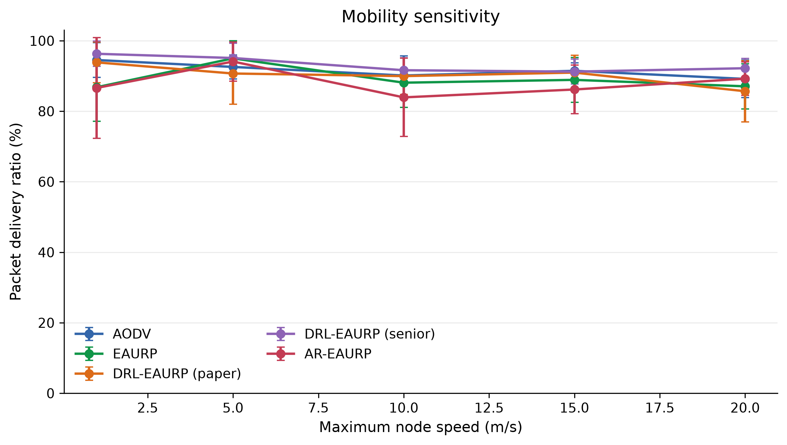
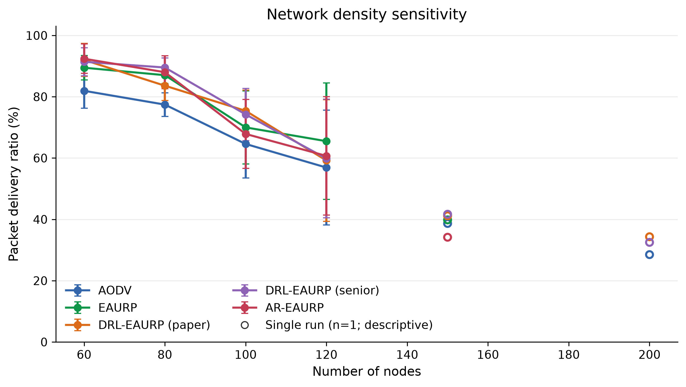
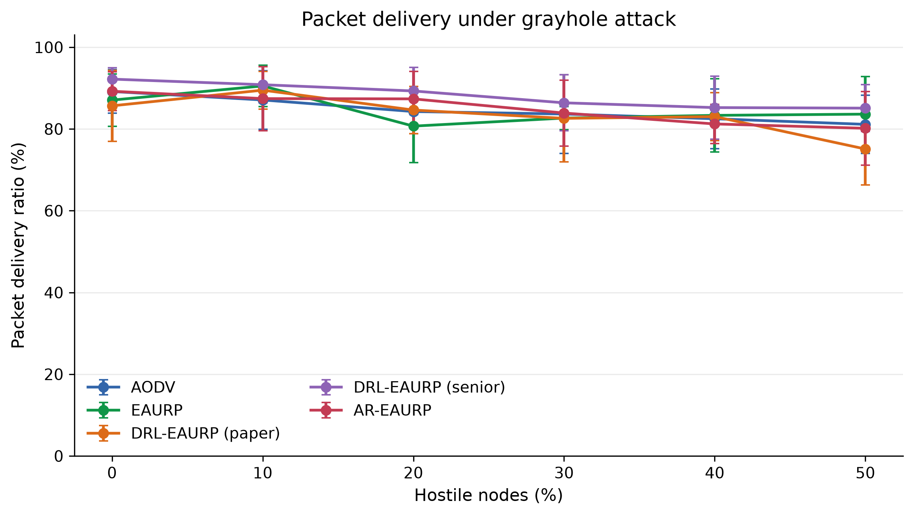
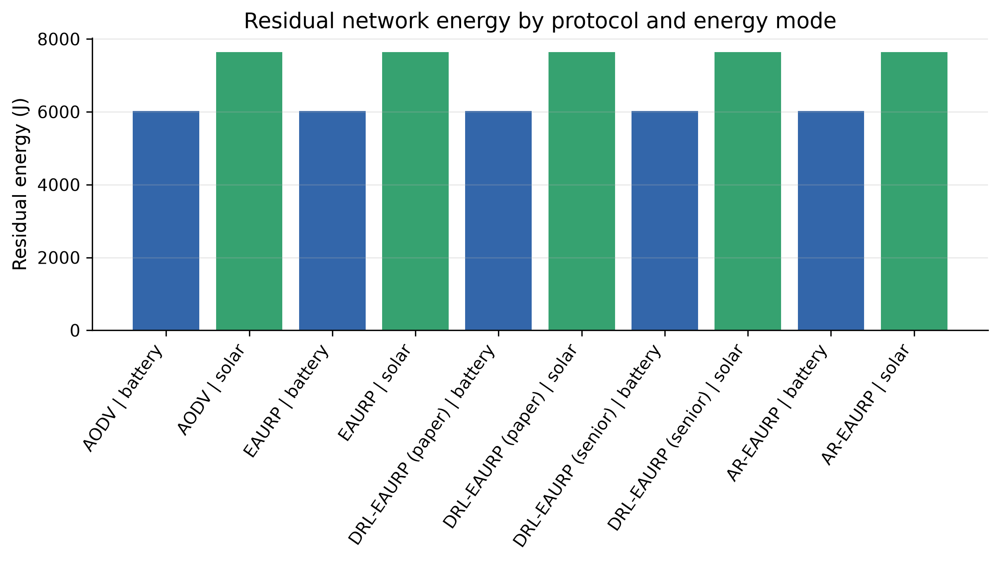
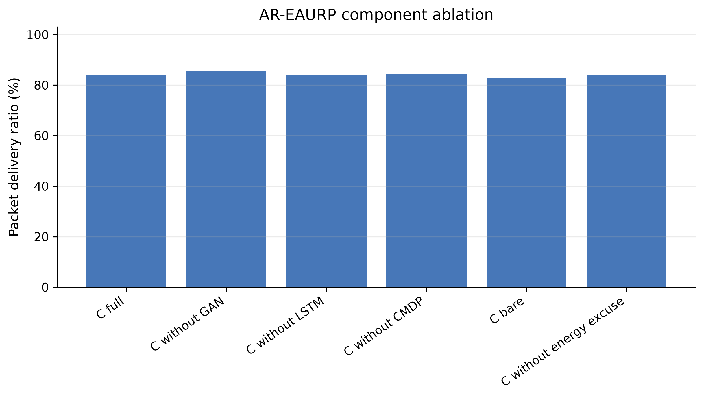

## Abstract

Routing in mobile ad hoc networks must tolerate changing wireless links, limited energy, and insider forwarding attacks. AR-EAURP extends a trust- and energy-aware routing substrate with size-conditioned watchdog features, a clean-trained generative anomaly detector, harvested-power forecasting with a validated fallback, and a constrained deep-Q route selector. This paper describes the implemented native C++ system and evaluates its behavior in ns-3.45. Five routing-policy adaptations are compared through mobility, density, attack prevalence, energy, lifetime, component-ablation, constraint, and protection-overhead experiments. The review matrix completed 863 of 905 planned replications across 179 of 181 conditions; the density sweep remains partial. At 30% gray-hole prevalence, AR-EAURP achieved PDR 83.90% ± 8.08% compared with EAURP's 82.67% ± 2.84%; the paired difference was +1.23 percentage points, with a 95% interval of −9.06 to +11.53. Window-level gray-hole detection was weak (TPR 7.82% ± 4.98%, FPR 5.24% ± 5.14%, AUC 0.55 ± 0.07). One of eighteen unadjusted AR–EAURP attack contrasts excluded zero, while a separate thirty-pair commissioning study estimated +1.16 points (95% CI −2.97 to +5.30). Harvesting increased modeled residual energy, but the learned forecaster did not outperform persistence in the selected workload. The findings establish an auditable packet-level implementation and identify concrete detection and learning limitations; they do not establish general protocol superiority or field performance.

**Keywords:** mobile ad hoc networks; trust-aware routing; selective forwarding; generative anomaly detection; energy harvesting; constrained reinforcement learning; ns-3; reproducible evaluation.

## 1. Introduction

Mobile ad hoc networks (MANETs) exchange traffic through cooperating wireless relays without fixed infrastructure. Route quality depends on more than distance: a nominally short route may contain a depleted node, an unstable wireless link, or a relay that deliberately discards traffic. Trust-aware routing attempts to distinguish reliable forwarding from misbehavior, while energy-aware routing attempts to avoid exhausting the relays needed for future connectivity. Combining these objectives creates a difficult decision problem because the available measurements are local, delayed, and noisy.

EAURP motivates the combination of energy, trust, and protected communication [2]. The present project asks whether additional behavioral observations and learning components can improve that substrate under explicit packet-level attacks. Selective forwarding is particularly relevant: a relay can preserve a reasonable aggregate forwarding ratio by dropping only some packet sizes. An energy forecast may help identify a relay that will recharge, but a forecast that loses to persistence can add complexity without useful information. A constrained learner may react to delivery shortfalls, yet an unrealistic floor or poor feedback can also destabilize routing.

The project first studied these ideas in a Python simulation used for an earlier Colab review. That stage was useful for implementing components and producing exploratory comparisons. It could not establish performance in an IEEE 802.11 packet network. The current work therefore implements the system natively in ns-3, where route discovery, MAC/PHY delivery, queuing, overhearing, battery drain, and attacker decisions occur through simulated events. Moving to a richer model is an evaluation step; it does not guarantee that an earlier numerical advantage will persist.

The contribution is both an implemented routing system and a transparent empirical assessment. First, the paper specifies the actual native feature vector, model architectures, routing actions, training split, feedback, and shared-policy assumptions. Second, it compares five policy adaptations over explicit factor sweeps and reports completed run counts and missing conditions. Third, it separates anomaly detection from consensus and revocation and separates packet delivery from learner feedback. Fourth, it reports uncertainty, unsuccessful ablations, and historical results without treating them as proof of superiority. These details allow a reader to identify what is implemented, what is measured, and what remains unsupported.

The evaluation addresses four questions. RQ1 asks how delivery changes with mobility, density, attack type, and hostile fraction. RQ2 asks whether size-conditioned anomaly detection identifies selective forwarding and whether that translates into usable routing decisions. RQ3 asks which energy, forecasting, learning, and protection components justify their cost. RQ4 asks whether the observed AR–EAURP delivery differences are stable across matched replications. The answer is mixed: some point estimates favor AR, but most attack contrasts and the larger commissioning follow-up remain inconclusive.

## 2. Related work and positioning

AODV discovers routes on demand using route requests and replies [1]. It provides a useful conceptual reference for hop-based forwarding but does not by itself solve insider trust or energy management. The AODV-style policy evaluated here shares the project's custom routing harness. This controlled implementation comparison should be distinguished from benchmarking against stock ns-3 AODV, which is only used separately for clean integration checks.

Watchdog-based mechanisms infer forwarding behavior from overheard transmissions. Marti et al. [3] demonstrated the value of forwarding observation and path selection under routing misbehavior. In a wireless model, however, failure to overhear can have benign explanations. The current implementation binds evidence to the intended next hop and cancels pending evidence after a failed MAC handoff. Its contribution is the specific measured combination of evidence accounting, size-conditioned features, and corroboration, rather than a new claim that overhearing perfectly identifies malicious behavior.

Generative adversarial learning [4] and generative anomaly detection [5] motivate fitting a representation of normal behavior without training on the evaluation attack. AR-EAURP uses an adversarially trained generator and a nearest-generated-vector score. This is an implementation choice whose usefulness must be assessed against observed TPR, FPR, and AUC. Clean training alone is insufficient to establish robustness to mobility or selective attacks, and the detector is not a calibrated probability estimator.

LSTM models [6] can represent temporal dependence, while energy-harvesting studies emphasize the variability of replenishable sources [14]. Here the predictor is tested against persistence and a recent-window mean with a purged chronological split. This prevents the paper from attributing routing benefits to a neural predictor that was not selected. The harvesting process is a controlled synthetic source; it is not evidence about a specific outdoor energy system.

Deep Q-learning [7], Double Q-learning [8], and constrained Markov decision processes [9] motivate the route strategy agent. The implemented Lagrangian penalty responds to measured delivery shortfall but does not guarantee satisfaction of a long-run constraint under nonstationary topology. The experiments therefore include floor sensitivity, component removal, and matched run comparisons. The earlier Python variants, native DRL adaptations, and published EAURP are related artifacts with different provenance; none is silently treated as an exact external reproduction.


## 3. System model and implementation

### 3.1 Network and routing substrate

The system consists of mobile wireless nodes that originate application traffic, discover routes, and relay packets over an IEEE 802.11 ad hoc network. Each node maintains neighbor information, residual energy, routing state, and locally available forwarding observations. Packets traverse actual ns-3 IP, MAC, and PHY events. Delivery therefore depends on route discovery, queueing, retransmission, interference, mobility, relay behavior, and battery state. A packet is not declared delivered by a single network-wide probability. This distinction is central to the transition from the earlier Python study to the native experiment.

The implementation is a native C++ ns-3.45 module. The detector, forecaster, neural-network operations, tabular agents, and constrained route selector execute within that module. Python scripts aggregate saved outcomes and prepare reports; they do not replace the packet path with an external predictor. The protocol uses route requests, route replies, route errors, neighbor advertisements, trust reports, and revocation-related control messages. A route can fail before an attacker is reached, so malicious-drop counters and total application loss measure different processes.

For a neighbor j, forwarding trust is smoothed as $T_j^{new}=0.7T_j^{old}+0.3PFR_j$, where PFR is the observed forwarding ratio. The trust and energy route score has the form $R_j=\operatorname{clip}(a_iT_j+b_iE_j^{eff},0,1)$. The adaptive energy weight uses the mean normalized energy of the node and its nonexpired neighbor advertisements; the trust weight is its complement. The link cost includes $(1-R_j)$ and a 0.35 hop penalty, represented internally in integer milli-cost units. This is a routing heuristic rather than a proof of an optimal path under the radio model.

Energy-aware variants exclude relays below 20% of their initial charge. The AODV-style reference uses equal hop costs and does not apply that energy gate. A contested AR neighbor receives an additional 0.5 trust multiplier for a 60 s contested interval. These choices can improve avoidance but also remove useful relays. Their possible cost is measured through PDR, delay, route failures, and component ablations.

### 3.2 Threat model

Attacks are insider forwarding and reputation attacks. Malicious nodes participate in the network and can forward control traffic while withholding relayed application packets. A black-hole relay drops relayed data. A gray-hole relay forwards smaller packets and independently drops eligible larger packets with probability 0.25, using a 700-byte size threshold. The trust-poisoning configuration combines selective forwarding with dishonest reports: a colluder advertises favorable trust for fellow malicious nodes and low trust for honest nodes. The explicit collusion assumption allows an attacker to recognize its allies. Honest routing does not receive that ground-truth attacker list as an avoidance policy.

The experiment varies the configured hostile fraction from 0% to 50% in ten-percentage-point steps. With a finite number of nodes, configured prevalence is not a guarantee that every route encounters an attacker or that every adversarial node obtains a forwarding opportunity. Selective packet eligibility, sparse observations, and route changes further separate attack prevalence from the number of positive detector windows. Consequently, a 30% gray-hole condition is not equivalent to dropping 30% of all generated packets.

The evaluated scope excludes physical jamming, malicious radio hardware, cryptographic key theft, wormholes, and arbitrary compromise of the simulator itself. A low delivery ratio can still arise from benign link failure or a depleted relay. These competing explanations motivate careful watchdog accounting and an energy excuse before trust condemnation. No formal anonymity or traffic-unobservability property is established by the experiments.

### 3.3 Watchdog observations and detection layers

The watchdog associates a forwarded packet digest with the intended next hop and confirms an overheard onward transmission using the neighbor MAC binding. A failed link-layer handoff cancels its pending watchdog entry, avoiding the automatic attribution of that failed handoff to malicious forwarding. A missing observation is therefore handled differently from a confirmed successful forwarding event. The watchdog timeout is 1 s. Published opinions require sufficient accumulated evidence, and an anomaly window requires at least six new observations.

The native detector consumes nine features: short-window PFR, long-window PFR, their difference, large-packet drop ratio, small-packet drop ratio, scaled mean forwarding latency, scaled latency standard deviation, report disagreement, and the difference between large- and small-packet drop ratios. Latencies are scaled by 0.1 s and capped at two; features are sanitized and clipped to the implemented range. Size-conditioned observations target selective forwarding that can remain hidden in a single average PFR.

Three measurement layers are retained. First, window-level TPR, FPR, and AUC describe thresholded anomaly scores and score ranking on eligible windows. Second, contested-node measurements describe corroborated suspicion with honest-witness requirements. Third, revocation measurements describe the protocol's final exclusion state. A correct anomaly score is not automatically a corroborated accusation, and an accusation is not automatically successful rerouting. The consensus logic requires at least two accusers and at least half of the relevant observers, subject to local evidence and energy checks. Ground-truth labels support evaluation; they are not a substitute for this inference path.

### 3.4 Clean-trained generative anomaly model

The detector is trained during a separate 240 s attack-free commissioning simulation. For feature k, clean training statistics define $z_k=(x_k-\mu_k)/\max(\sigma_k,10^{-3})$. At least 32 clean windows are required. The generator maps an eight-dimensional latent vector through two 32-unit ReLU layers to nine outputs. The discriminator uses layers of 32 and 16 units with leaky ReLU activations and a sigmoid output. Adversarial training uses 120 epochs, batches of 16, a learning rate of $2\times10^{-4}$, and one-sided real-label smoothing to 0.9. These are native implementation settings, not parameters copied from the older Python detector.

Following training, the generator produces a bank B of 2,048 standardized normal behavior vectors. The inference score is the nearest generated-vector root-mean-square distance:

$$s(x)=\min_{b\in B}\sqrt{\frac{1}{9}\sum_{k=1}^{9}(z_k-b_k)^2}.$$

The threshold is the 95th percentile of scores on the collected clean training windows. The score is not a maliciousness probability and is not the discriminator's real-versus-generated output. The model is related to generative anomaly modeling [4,5], but the generated-bank inference procedure is specific to this project. In particular, it does not optimize a latent vector separately for every evaluation sample.

Detector parameters are frozen for attack evaluation. This separates attack observations from model fitting, but the same clean collection is used for fitting and threshold calibration. The threshold therefore lacks an independent clean calibration set, and nominal 5% calibration does not guarantee a 5% FPR on new network conditions. Mobility, neighborhood changes, sparse evidence, and channel-induced losses can alter the score distribution. The measured evaluation FPR is reported instead of assuming the calibration target was achieved.

### 3.5 Harvest forecasting and fallback selection

The forecaster predicts mean harvested power over the next ten samples from a history of twenty samples. At each 1 s sample, the inputs are normalized harvested power and the sine and cosine of the modeled day phase. A 24-unit LSTM [6] is trained for 30 epochs with learning rate 0.005. Its target is power in watts, not cumulative battery energy. Routing blends current normalized energy and normalized predicted harvested power for its energy-oriented action.

For each node's commissioning trace, the earliest 70% supplies training data and the last 30% supplies validation. Sequences crossing the split are purged, and normalization uses training power only. Persistence and a recent-window mean are evaluated on the same held-out targets. The LSTM is used for routing only when its validation MAE is strictly below persistence; otherwise prediction falls back to persistence. The field historically named seasonal MAE corresponds to a window-mean predictor, so this paper does not call it a seasonal forecasting baseline.

All traces contribute to shared model parameters. There is one fleet-trained detector and one fleet-trained forecaster, rather than a separately trained network at each node. Provisioning such models is a plausible deployment step, but training communication, model distribution, and hardware inference cost are not evaluated as a distributed field system. Reporting the fallback outcome is necessary: an experiment in which persistence is selected cannot be cited as evidence that the LSTM improved delivery.

### 3.6 Constrained learning for route strategy selection

The CMDP-inspired agent chooses among trust-oriented, energy-surplus, balanced, and diversified routing strategies. Its six state variables are mean local trust, own residual-energy fraction, normalized speed, forecast surplus, contested-neighbor fraction, and rolling application feedback PDR. The feedback window contains the latest 100 delivery outcomes. Before feedback exists, its initial PDR value is one. This online state differs from the final measured application PDR and can be affected by timeout feedback.

The route selector uses a six-input, two-hidden-layer network with 64 ReLU units per layer and four action values. Its Double-DQN target [7,8] is

$$y=r+0.9Q_{target}(s',\arg\max_a Q_{online}(s',a)).$$

The shaped reward is

$$r=(2I_{delivered}-1)-0.05c_E-5\lambda\max(0,\tau-\widehat{PDR}_{100}).$$

Here $c_E$ is a hop-based energy proxy, and $\tau$ is the target delivery floor. The proxy derives from a 2 mJ-per-hop assumption and internal scaling; it is not the radio energy consumed by the packet. Actual battery behavior is measured separately through the ns-3 energy model. Every ten source attempts, the dual variable is updated as $\lambda\leftarrow\operatorname{clip}(\lambda+0.05(\tau-\widehat{PDR}_{100}),0,20)$.

The replay buffer holds 5,000 transitions; batch size is 32, learning rate is 0.001, and training is attempted every four observations. Target parameters use a hard copy every 200 training calls and a 0.01 Polyak update otherwise. Epsilon decays from 0.30 toward 0.05 with an 800-decision time constant. Exploration and shared policy updates continue during evaluation. The current implementation also learns from clean commissioning outcomes, rather than first activating the route learner under attack.

One CMDP agent is shared through the native experiment coordinator. This parameter sharing is a substantive simulation assumption: the study evaluates a coordinated fleet policy, not independently learning decentralized agents. The Lagrangian construction is motivated by constrained decision processes [9], but no convergence, constraint-feasibility, or safety guarantee follows from the implemented finite-run learner. The floor sweep explicitly measures whether higher targets translate into higher observed delivery.

### 3.7 Baseline definitions and protected payloads

All five comparison policies share the native packet harness. AODV denotes the custom equal-hop AODV-style reference; it is not ns-3's stock AODV implementation [1]. A separate ns3-aodv integration option exists for clean checks but is not included in the attack matrix. EAURP is the project's trust/energy substrate adaptation, inspired by the base protocol [2]. DRL-P and DRL-S denote native adaptations of the source-equation and delivered-implementation variants. Their tabular agent discretizes state, uses two actions, learning rate 0.1, discount 0.9, epsilon 0.1, and actual delivery feedback. Their behavior must not be described as verbatim reproduction of an external publication's complete original implementation.

Protected application traffic uses X25519 key agreement, HKDF-SHA256 key derivation, and AES-256-GCM authenticated encryption [10–12]. A 12-byte nonce and 16-byte tag add 28 bytes per protected payload. The measured aggregate overhead includes the packets counted by the native instrumentation; it is not simply the number of measured source packets multiplied by 28. Key provisioning is trusted in the simulation. Payload protection does not prove authentication of every routing advertisement or traffic-analysis resistance. The no-ECC label in saved outputs disables the implemented payload protection path and should be interpreted in that operational sense.

## 4. Experimental methodology

### 4.1 Radio, workload, mobility, and energy settings

The experiments use ns-3.45 [13] with IEEE 802.11b ad hoc operation and fixed 2 Mbit/s DSSS transmission. Log-distance path loss has exponent 3 and reference loss 40.05 dB at 1 m, followed by Nakagami fading. Transmit power is 16.0206 dBm; receiver sensitivity is −96 dBm. The 150 m distance used in connectivity diagnostics is not a hard reception cutoff. This is a simulated wireless environment with channel and packet effects, rather than physical deployment evidence.

Table 1 records the base configuration. Random waypoint motion uses a uniform speed from 1 m/s to the selected maximum and pauses up to 2 s. Packet sizes are uniformly drawn from 512–1,024 bytes, so the gray-hole size rule sees both eligible and ineligible packets. Six CBR flows generate one packet per second each. The base evaluation horizon is 120 s, of which 20 s is warm-up. The actual metric denominator is 100 s, corresponding to 600 measured source packets. An additional 10 s cooldown permits final deliveries. AR clean commissioning is separate from this horizon. The 900 s lifetime condition has 880 s after warm-up.

Table 1. Native base settings and evaluation boundaries.

| Setting | Value |
|---|---|
| Engine and implementation | ns-3.45; native C++ |
| Base network | 24 nodes; six CBR flows; 420 × 420 m |
| Traffic | 1 packet/s/flow; uniform 512–1,024 bytes |
| Evaluation timing | 120 s scenario; 20 s excluded warm-up; 100 s measured; 10 s cooldown |
| Commissioning | Separate clean 240 s simulation for AR models and route learning |
| Mobility | Random waypoint; 1–20 m/s base range; 0–2 s pause |
| Radio | 802.11b ad hoc; 2 Mbit/s DSSS; 16.0206 dBm |
| Propagation | Log-distance exponent 3; Nakagami fading; constant-speed delay |
| Initial charge | 350 J per node |
| Harvesting | 70% panel-equipped nodes; 600 s modeled day; solar and kinetic input |
| Review RNG | Seed 20260909; matched RngRun 1–5 |
| Default AR floor | 0.90; continuing online learning and exploration |
| Batch pacing | Simulated time; wall-clock pacing disabled |

The battery uses the ns-3 Wi-Fi radio energy model. Harvesting combines a modeled solar input and a speed-dependent kinetic term. The solar process uses a 1.2 W panel peak, a compressed 600 s day, and temporally correlated cloud variation; the kinetic coefficient is 0.004 W per m/s. These assumptions allow controlled comparisons within the model but do not calibrate a particular panel, climate, battery chemistry, or radio device [14]. Residual-energy results are network totals in joules, not energy per node.

### 4.2 Factor sweeps and actual completion

The design varies mobility (E1), density (E2), attack type and prevalence (E3), harvesting (E4), lifetime (E4b), component removal (E5), delivery-floor selection (E5b), and payload-protection overhead (E6). These are structured factor sweeps, not an exhaustive Cartesian product of every parameter. E1, E2, E4, and E4b use their clean scenario settings; E5, E5b, and E6 use 30% gray-hole evaluation. Exact overrides are preserved in the condition and run ledgers.

Table 2. Completed experimental coverage; missing runs are not imputed.

| Experiment | Factor levels | Conditions completed/planned | Runs completed/planned |
|---|---|---:|---:|
| E1 mobility | Five policies × 1, 5, 10, 15, 20 m/s | 25/25 | 125/125 |
| E2 density | Five policies × 60, 80, 100, 120, 150, 200 nodes | 28/30 | 108/150 |
| E3 attacks | Five policies × three attacks × 0–50%, step 10% | 90/90 | 450/450 |
| E4 energy | Five policies × battery/harvesting | 10/10 | 50/50 |
| E4b lifetime | Five policies × energy mode; 900 s horizon | 10/10 | 50/50 |
| E5 ablation | Full and five component-removal settings | 6/6 | 30/30 |
| E5b delivery floor | 0.70, 0.80, 0.90, 0.95 | 4/4 | 20/20 |
| E6 overhead | Five policies and AR without payload protection | 6/6 | 30/30 |
| Total | Structured review matrix | 179/181 | 863/905 |

The incomplete portion is confined to E2. All five policies have five runs at 60, 80, 100, and 120 nodes. All have one run at 150 nodes. At 200 nodes, only AODV, DRL-P, and DRL-S have one run; EAURP and AR are absent. The 42 deferred replications were stopped by a time limit. Their absence precludes a complete high-density comparison and may bias a summary that ignores the coverage pattern. A single-run outcome is shown as descriptive, without an empirical standard deviation or confidence interval.

### 4.3 Endpoints and statistical analysis

PDR equals the number of uniquely received measured application packets divided by measured generated packets. Delivered packets may arrive during cooldown. Throughput is received application bytes times eight divided by measured seconds. Mean delay is computed over delivered packets, so it is conditional on survival: an attacker can lower measured delay by eliminating difficult packets. A lower delay paired with much lower PDR is not automatically a routing improvement. Application delivery and the route learner's timeout feedback are distinct counters and can disagree for late deliveries.

Window-level TPR is TP/(TP+FN), FPR is FP/(FP+TN), and AUC summarizes ranking of anomaly scores when both classes are available. Clean-only conditions lack positive attack windows; a stored zero TPR or default AUC of 0.5 is not an observed successful detector. Baselines without the AR detector have no comparable detector endpoint. Repeated windows from the same node are dependent; the independent unit for reported variability is the simulation replication, not the number of packets or windows.

Each complete condition has five stochastic replications using one fixed master seed and distinct ns-3 run numbers. These are five run streams, not five distinct master seeds. Means and sample SDs summarize run-level measurements. Two-sided 95% Student t intervals use $\bar{x}\pm t_{0.975,n-1}s/\sqrt{n}$. Rate intervals in the saved tables are clipped to the allowed range; this is descriptive bounding, not a binomial interval construction. With five runs, estimates remain sensitive to topology and outliers.

For a matched protocol comparison, $d_r=100(PDR_{AR,r}-PDR_{EAURP,r})$ is measured in percentage points. The same t construction is applied to these paired differences. Matching seed and run number reduces configuration mismatch but does not enforce identical event-level random draws: protocol execution changes random-stream consumption. E3 contains 18 AR–EAURP rows and 180 all-policy contrasts. Intervals are unadjusted, exploratory, and not a family-wise claim of significance. The zero-hostile scenario is repeated under three attack labels and must not be counted as three independent clean validations.

Lifetime endpoints are time to first death and time until 80% of nodes have died. If an endpoint has not occurred by the horizon, the observation is right-censored. Censored horizon or sentinel values are not treated as observed event times. The present report describes event flags and observed endpoints, without claiming a full survival analysis. The separate 30-pair commissioning follow-up uses seed 1 and run numbers 21–50 and is kept separate from the review matrix. Its larger sample size does not increase the number of independent replications in any E3 cell.


## 5. Results

Unless stated otherwise, table entries are run means ± sample SD and PDR/TPR/FPR values are percentages. DRL-P and DRL-S correspond to the saved labels DRL-EAURP (paper) and DRL-EAURP (senior). All comparisons concern the defined native adaptations.

### 5.1 Mobility and density

At 1, 5, 10, 15, and 20 m/s maximum speed, AR PDR was 86.60 ± 14.32%, 94.10 ± 5.56%, 83.93 ± 11.10%, 86.17 ± 6.90%, and 89.23 ± 4.73%, respectively. EAURP produced 86.80 ± 9.64%, 95.00 ± 4.99%, 88.10 ± 7.01%, 88.90 ± 6.38%, and 87.07 ± 6.41%. Neither sequence is monotonic. The results do not support a uniform mobility advantage for AR; at several speeds the simpler references have higher descriptive PDR. Figure 1 shows the five-policy comparison.





At 60 and 80 nodes, AR's PDR means were 92.40% and 88.00%, compared with EAURP's 89.47% and 87.03%. At 100 and 120 nodes, AR fell to 67.87% and 60.70%, compared with 70.00% and 65.50%. At 120 nodes the between-run SDs were about 19 points for both protocols. These large variations limit fine rankings. The 150-node AR observation was 34.17% with n=1; no AR result exists at 200 nodes. Figure 2 retains this incomplete coverage.

The density sweep changes node count at fixed area and six-flow load. Increased neighbor interactions, discovery activity, channel contention, and route-policy responses are plausible contributors to degradation, but this factor sweep does not isolate their causal effects. It also changes traffic per node. It would be incorrect to present the partial high-density points as a replicated scalability limit or to infer a universal node-count threshold.





### 5.2 Delivery under black-hole, gray-hole, and trust-poisoning attacks

Tables 3–5 provide every hostile-percentage PDR result. Black holes cause a pronounced delivery collapse for all policies. At 30% hostile nodes, AR delivered 38.47% compared with EAURP's 40.80%; at 50%, both were near 21–22%. AR's high black-hole window TPR therefore does not imply preserved connectivity. Correct local detection can occur after losses, without enough trustworthy alternative relays, or without adequate corroboration. The measured result is poor delivery despite strong separation of the most obvious anomaly class.

Table 3. Black-hole PDR (%) across all five native policies; n=5 per cell.


| Hostile nodes | AODV | EAURP | DRL-EAURP (paper) | DRL-EAURP (senior) | AR-EAURP |
|---:|---:|---:|---:|---:|---:|
| 0% | 89.17 ± 5.34 | 87.07 ± 6.41 | 85.67 ± 8.71 | 92.20 ± 2.78 | 89.23 ± 4.73 |
| 10% | 44.80 ± 3.62 | 71.33 ± 15.58 | 71.67 ± 13.16 | 41.27 ± 10.03 | 63.67 ± 16.29 |
| 20% | 28.57 ± 9.14 | 45.80 ± 23.59 | 50.17 ± 14.74 | 34.93 ± 9.25 | 45.47 ± 18.08 |
| 30% | 30.37 ± 6.55 | 40.80 ± 15.61 | 38.40 ± 14.38 | 25.97 ± 9.38 | 38.47 ± 15.13 |
| 40% | 23.13 ± 8.54 | 30.33 ± 15.43 | 29.30 ± 15.53 | 24.20 ± 12.06 | 33.77 ± 10.16 |
| 50% | 24.80 ± 11.27 | 20.53 ± 9.06 | 25.07 ± 9.73 | 21.77 ± 11.73 | 21.83 ± 7.74 |


Gray-hole delivery degrades less sharply because only eligible larger packets are selectively dropped. At 30%, AR's mean PDR was 83.90% versus EAURP's 82.67% and DRL-S's 86.40%. AR is not the best descriptive policy in that cell. Its paired advantage over EAURP was +1.23 points with a wide interval spanning appreciable benefit and harm. At 20%, AR's point advantage was +6.67 points, but the interval still included zero. At 40% and 50%, the AR–EAURP means were negative. This pattern does not support a consistent prevalence-dependent improvement.

Table 4. Gray-hole PDR (%) across all five native policies; n=5 per cell.


| Hostile nodes | AODV | EAURP | DRL-EAURP (paper) | DRL-EAURP (senior) | AR-EAURP |
|---:|---:|---:|---:|---:|---:|
| 0% | 89.17 ± 5.34 | 87.07 ± 6.41 | 85.67 ± 8.71 | 92.20 ± 2.78 | 89.23 ± 4.73 |
| 10% | 87.10 ± 7.19 | 90.53 ± 5.05 | 89.50 ± 4.62 | 90.83 ± 4.44 | 87.43 ± 7.86 |
| 20% | 84.27 ± 5.43 | 80.70 ± 8.88 | 84.63 ± 5.76 | 89.30 ± 5.79 | 87.37 ± 6.72 |
| 30% | 83.67 ± 9.62 | 82.67 ± 2.84 | 82.60 ± 10.65 | 86.40 ± 6.85 | 83.90 ± 8.08 |
| 40% | 82.50 ± 7.31 | 83.33 ± 8.92 | 83.03 ± 5.88 | 85.23 ± 7.72 | 81.23 ± 4.75 |
| 50% | 81.13 ± 7.15 | 83.63 ± 9.21 | 75.10 ± 8.81 | 85.10 ± 5.73 | 80.17 ± 8.99 |





Trust poisoning has a larger impact on the trust-sensitive policies than on the equal-hop reference. At 30%, EAURP and AR obtained 56.90% and 54.60%, while the AODV-style reference and DRL-S retained the same aggregate PDR as their gray-hole configurations. This is consistent with differences in how policies use the poisoned reports; it is not proof that those policies resist every reputation attack. At 20%, AR exceeded EAURP by +11.07 points, with an unadjusted 95% paired interval of +1.35 to +20.79. This is the only one of the eighteen displayed AR–EAURP intervals excluding zero. Its exploratory status and the lack of multiplicity adjustment prevent a broad superiority claim.

Table 5. Trust-poisoning PDR (%) across all five native policies; n=5 per cell.


| Hostile nodes | AODV | EAURP | DRL-EAURP (paper) | DRL-EAURP (senior) | AR-EAURP |
|---:|---:|---:|---:|---:|---:|
| 0% | 89.17 ± 5.34 | 87.07 ± 6.41 | 85.67 ± 8.71 | 92.20 ± 2.78 | 89.23 ± 4.73 |
| 10% | 87.10 ± 7.19 | 83.53 ± 9.72 | 78.83 ± 11.29 | 90.83 ± 4.44 | 80.47 ± 8.18 |
| 20% | 84.27 ± 5.43 | 61.13 ± 14.01 | 78.47 ± 11.74 | 89.30 ± 5.79 | 72.20 ± 17.50 |
| 30% | 83.67 ± 9.62 | 56.90 ± 14.72 | 70.47 ± 10.84 | 86.40 ± 6.85 | 54.60 ± 12.97 |
| 40% | 82.50 ± 7.31 | 48.13 ± 12.71 | 57.83 ± 8.58 | 85.23 ± 7.72 | 58.00 ± 14.81 |
| 50% | 81.13 ± 7.15 | 48.50 ± 11.02 | 54.00 ± 7.28 | 85.10 ± 5.73 | 47.03 ± 14.20 |


### 5.3 Detection, corroboration, and paired uncertainty

Table 6 combines the anomaly measurements with all eighteen matched AR–EAURP delivery differences. Black-hole detection has mean window TPR of roughly 93–100% at nonzero prevalence, while gray-hole TPR remains about 2–10%. At 30% gray holes, AUC is 0.55 ± 0.07 and FPR is 5.24% ± 5.14%, indicating weak score separation in this workload. Trust-poisoning AUC also remains close to chance and falls below 0.5 in some cells. These observations do not justify describing the native detector as highly accurate against selective or reputational attacks.

Table 6. AR window-level detector metrics and paired PDR differences; percentage endpoints except AUC. Intervals are unadjusted and exploratory.


| Attack | Hostile nodes | AR window TPR | AR window FPR | AR score AUC | AR−EAURP PDR (pp) | Paired 95% CI (pp) | AR wins |
|---|---:|---:|---:|---:|---:|---:|---:|
| blackhole | 0% | 0.00 ± 0.00 | 5.51 ± 2.94 | 0.50 ± 0.00 | 2.17 | [-4.68, 9.02] | 4/5 |
| blackhole | 10% | 96.00 ± 8.94 | 6.63 ± 3.82 | 0.98 ± 0.02 | -7.67 | [-21.75, 6.41] | 2/5 |
| blackhole | 20% | 100.00 ± 0.00 | 7.26 ± 6.98 | 0.97 ± 0.03 | -0.33 | [-9.36, 8.69] | 2/5 |
| blackhole | 30% | 93.42 ± 8.17 | 10.97 ± 5.12 | 0.97 ± 0.04 | -2.33 | [-11.33, 6.66] | 2/5 |
| blackhole | 40% | 100.00 ± 0.00 | 13.69 ± 13.12 | 0.97 ± 0.06 | 3.43 | [-9.16, 16.03] | 2/5 |
| blackhole | 50% | 99.05 ± 2.13 | 12.29 ± 12.89 | 0.98 ± 0.05 | 1.30 | [-6.35, 8.95] | 2/5 |
| grayhole | 0% | 0.00 ± 0.00 | 5.51 ± 2.94 | 0.50 ± 0.00 | 2.17 | [-4.68, 9.02] | 4/5 |
| grayhole | 10% | 6.19 ± 8.52 | 5.89 ± 3.45 | 0.55 ± 0.15 | -3.10 | [-8.64, 2.44] | 1/5 |
| grayhole | 20% | 2.36 ± 3.24 | 3.26 ± 2.49 | 0.62 ± 0.11 | 6.67 | [-3.90, 17.24] | 4/5 |
| grayhole | 30% | 7.82 ± 4.98 | 5.24 ± 5.14 | 0.55 ± 0.07 | 1.23 | [-9.06, 11.53] | 2/5 |
| grayhole | 40% | 9.83 ± 5.31 | 4.04 ± 4.53 | 0.59 ± 0.12 | -2.10 | [-12.75, 8.55] | 2/5 |
| grayhole | 50% | 9.29 ± 5.79 | 3.94 ± 3.54 | 0.56 ± 0.11 | -3.47 | [-10.35, 3.42] | 1/5 |
| trust poisoning | 0% | 0.00 ± 0.00 | 5.51 ± 2.94 | 0.50 ± 0.00 | 2.17 | [-4.68, 9.02] | 4/5 |
| trust poisoning | 10% | 3.33 ± 7.45 | 7.40 ± 1.32 | 0.46 ± 0.17 | -3.07 | [-16.22, 10.09] | 3/5 |
| trust poisoning | 20% | 8.30 ± 6.04 | 7.64 ± 5.16 | 0.51 ± 0.03 | 11.07 | [1.35, 20.79] | 5/5 |
| trust poisoning | 30% | 12.31 ± 8.77 | 5.00 ± 4.06 | 0.51 ± 0.13 | -2.30 | [-14.62, 10.02] | 2/5 |
| trust poisoning | 40% | 10.94 ± 3.96 | 7.70 ± 2.95 | 0.49 ± 0.04 | 9.87 | [-1.37, 21.10] | 4/5 |
| trust poisoning | 50% | 10.17 ± 3.20 | 7.21 ± 5.36 | 0.39 ± 0.05 | -1.47 | [-21.89, 18.95] | 2/5 |


For the 30% gray-hole condition, the separately recorded contested TPR was 0%, contested FPR 1.18%, revocation TPR 14.29%, and revocation FPR 11.76% as run means. These metrics use different event/state definitions and denominators from anomaly windows. Their disagreement is informative: a window score, a corroborated accusation, and a final trust exclusion describe different stages of the routing mechanism. In particular, a revocation can arise from ordinary trust logic without a successful GAN accusation. Reporting only the most favorable layer would conceal this distinction.

The three clean rows share the same underlying configuration and default no-positive-class behavior. Their TPR/AUC values cannot validate sensitivity. Across nonzero attacks, there is no fixed ordering of PDR that follows from detector TPR alone. The results support further work on observable evidence and robust scoring, rather than a claim that adding a neural detector automatically improves routing.

### 5.4 Energy and lifetime

Table 7 shows clean energy-mode results. AR residual energy increased from 6,022.38 ± 2.18 J without harvesting to 7,639.45 ± 207.81 J with harvesting. PDR changed from 87.47 ± 4.41% to 89.23 ± 4.73%. Similar residual-energy increases occur for all policies. Because added environmental energy directly changes the battery balance, the energy increase should not be attributed entirely to better route selection. No nodes died during the short E4 runs.

Table 7. Energy-mode PDR, total network residual energy, and dead-node count.


| Configuration | PDR | Residual energy (J) | Dead nodes |
|---|---|---|---|
| AODV / battery | 89.17 ± 5.34 | 6022.93 ± 2.25 | 0.00 ± 0.00 |
| AODV / solar | 89.17 ± 5.34 | 7640.87 ± 207.91 | 0.00 ± 0.00 |
| EAURP / battery | 88.83 ± 2.98 | 6021.79 ± 1.85 | 0.00 ± 0.00 |
| EAURP / solar | 87.07 ± 6.41 | 7640.65 ± 207.70 | 0.00 ± 0.00 |
| DRL-EAURP (paper) / battery | 82.93 ± 13.70 | 6021.05 ± 4.12 | 0.00 ± 0.00 |
| DRL-EAURP (paper) / solar | 85.67 ± 8.71 | 7638.78 ± 208.57 | 0.00 ± 0.00 |
| DRL-EAURP (senior) / battery | 89.10 ± 4.57 | 6021.75 ± 2.39 | 0.00 ± 0.00 |
| DRL-EAURP (senior) / solar | 92.20 ± 2.78 | 7639.39 ± 207.71 | 0.00 ± 0.00 |
| AR-EAURP / battery | 87.47 ± 4.41 | 6022.38 ± 2.18 | 0.00 ± 0.00 |
| AR-EAURP / solar | 89.23 ± 4.73 | 7639.45 ± 207.81 | 0.00 ± 0.00 |





In the 900 s lifetime experiment, all battery-only policies reached first death at about 423 s and 80% dead at about 425 s. AR first death changed from 423.60 ± 0.69 s to 432.79 ± 1.90 s with harvesting. The aggregate observation flag for the harvested 80%-dead endpoint is zero for every policy: none of those endpoints was observed in the five runs before the horizon. Those cases are right-censored at 900 s; they are not measured death times. Table 8 preserves the original censored marker. End-of-run residual energy and first-death times support an effect within the synthetic energy model, not a validated field-lifetime multiplier.

Table 8. Lifetime endpoints and total remaining energy. Harvested 80%-dead endpoints are censored in all five runs per policy.


| Configuration | First death (s) | 80% dead (s) | Residual energy (J) |
|---|---|---|---|
| AODV / battery | 422.65 ± 0.56 | 424.55 ± 0.15 | 0.00 ± 0.00 |
| AODV / solar | 432.10 ± 2.28 | censored / mixed | 1395.71 ± 166.72 |
| EAURP / battery | 423.30 ± 0.58 | 424.90 ± 0.20 | 0.00 ± 0.00 |
| EAURP / solar | 432.84 ± 1.55 | censored / mixed | 1370.50 ± 190.10 |
| DRL-EAURP (paper) / battery | 423.50 ± 0.38 | 424.98 ± 0.33 | 0.00 ± 0.00 |
| DRL-EAURP (paper) / solar | 432.20 ± 2.51 | censored / mixed | 1402.79 ± 212.21 |
| DRL-EAURP (senior) / battery | 422.89 ± 0.58 | 424.76 ± 0.11 | 0.00 ± 0.00 |
| DRL-EAURP (senior) / solar | 432.12 ± 2.34 | censored / mixed | 1394.65 ± 167.13 |
| AR-EAURP / battery | 423.60 ± 0.69 | 425.12 ± 0.34 | 0.00 ± 0.00 |
| AR-EAURP / solar | 432.79 ± 1.90 | censored / mixed | 1360.29 ± 212.01 |


### 5.5 Ablations, forecast quality, and delivery-floor sensitivity

Table 9 shows the component-removal experiment at 30% gray holes. Full AR achieved 83.90 ± 8.08% PDR, versus 85.63 ± 8.04% without GAN and 84.50 ± 7.35% without CMDP. These point estimates do not establish that the complete stack outperforms its simpler variants. The energy-excuse removal matched the full configuration in the reported endpoints. This equality is a result for this workload, not evidence that the mechanism can never matter. Removing components can change routes and hence the windows available to the detector, so differences are not independent causal contributions that can be added together.

Table 9. Component ablations. Disabled-detector zeros/default AUC are not classification results.


| Configuration | PDR | Window TPR | Window FPR | Score AUC |
|---|---|---|---|---|
| C full | 83.90 ± 8.08 | 7.82 ± 4.98 | 5.24 ± 5.14 | 0.55 ± 0.07 |
| C without GAN | 85.63 ± 8.04 | 0.00 ± 0.00 | 0.00 ± 0.00 | 0.50 ± 0.00 |
| C without LSTM | 83.97 ± 7.25 | 8.89 ± 8.43 | 5.92 ± 3.67 | 0.56 ± 0.03 |
| C without CMDP | 84.50 ± 7.35 | 6.77 ± 8.57 | 5.55 ± 5.21 | 0.60 ± 0.09 |
| C bare | 82.67 ± 2.84 | 0.00 ± 0.00 | 0.00 ± 0.00 | 0.50 ± 0.00 |
| C without energy excuse | 83.90 ± 8.08 | 7.82 ± 4.98 | 5.24 ± 5.14 | 0.55 ± 0.07 |





The forecaster provides a particularly important negative result. In the full 30% gray-hole configuration, LSTM holdout MAE was 0.495 ± 0.409 W, persistence MAE 0.057 ± 0.013 W, and window-mean MAE 0.095 ± 0.028 W. Persistence was selected in all five runs. Thus the experiment tests the fallback-equipped forecasting module, but it does not demonstrate useful LSTM prediction. The native system correctly avoids deploying the worse predictor under its selection rule. Improving model capacity without changing the short training horizon or validation design is not established as the solution.

Table 10 shows that delivery is not monotonic in the target floor. The 0.80 floor produced the highest descriptive PDR, 88.63 ± 4.07%; floors 0.90 and 0.95 produced 83.90 ± 8.08% and 78.20 ± 12.22%. Lambda increased with the stricter floors, showing that the penalty reacted, but a larger penalty did not ensure constraint satisfaction. These finite-run results identify a learning and feedback problem; they do not prove mathematical infeasibility of the underlying constrained routing problem. Choosing 0.80 after examining this sweep would require fresh confirmatory evaluation.

Table 10. Delivery-floor sensitivity and final/peak dual variable; n=5 per setting.


| Configuration | PDR | Final CMDP λ | Peak CMDP λ |
|---|---|---|---|
| C floor=0.70 | 70.77 ± 20.20 | 0.43 ± 0.54 | 0.50 ± 0.50 |
| C floor=0.80 | 88.63 ± 4.07 | 0.70 ± 0.65 | 0.86 ± 0.54 |
| C floor=0.90 | 83.90 ± 8.08 | 1.69 ± 0.76 | 1.71 ± 0.72 |
| C floor=0.95 | 78.20 ± 12.22 | 2.33 ± 0.99 | 2.33 ± 0.99 |


### 5.6 Payload protection and control overhead

At 30% gray holes, AR generated 218,395 ± 14,430 control bytes and 30,906 ± 1,356 cryptographic overhead bytes, with delay 0.28 ± 0.14 s. EAURP generated 224,339 ± 10,551 control bytes, about 30,654 ± 495 cryptographic bytes, and delay 0.27 ± 0.08 s. The no-protection AR setting recorded zero cryptographic bytes, PDR 84.03 ± 4.51%, and delay 0.24 ± 0.16 s. Table 11 reports all variants. Changing protection also changes packet sizes and subsequent network events; the observed delay difference is not an isolated measurement of cryptographic CPU latency. No claim is made about hardware execution time or formal security strength from these performance counters.

Table 11. Application PDR, aggregate protection/control bytes, and conditional delivered-packet delay.


| Configuration | PDR | Crypto overhead (B) | Control bytes | Delay (s) |
|---|---|---|---|---|
| AODV | 83.67 ± 9.62 | 30856.00 ± 1620.25 | 180906.20 ± 13723.64 | 0.21 ± 0.14 |
| EAURP | 82.67 ± 2.84 | 30654.40 ± 494.74 | 224338.60 ± 10550.78 | 0.27 ± 0.08 |
| DRL-EAURP (paper) | 82.60 ± 10.65 | 30699.20 ± 1761.51 | 223893.80 ± 31384.10 | 0.23 ± 0.10 |
| DRL-EAURP (senior) | 86.40 ± 6.85 | 31326.40 ± 1143.28 | 206686.40 ± 14286.77 | 0.21 ± 0.06 |
| AR-EAURP | 83.90 ± 8.08 | 30906.40 ± 1355.82 | 218395.00 ± 14430.38 | 0.28 ± 0.14 |
| C without ECC | 84.03 ± 4.51 | 0.00 ± 0.00 | 230747.60 ± 24773.70 | 0.24 ± 0.16 |


### 5.7 Separate thirty-pair commissioning follow-up

The commissioning-trained CMDP was additionally evaluated against EAURP with seed 1 and matched run numbers 21–50, at 24 nodes, six flows, and 25% gray-hole prevalence. This cohort is separate from E3. EAURP mean PDR was 79.81% and AR mean PDR was 80.97%. AR won 16 of 30 pairs. The paired estimate was +1.16 points with 95% CI −2.97 to +5.30. Mean delay changed from 0.256 s to 0.288 s; its paired difference was +32 ms with interval −21 to +84 ms. Neither endpoint establishes a reliable benefit.

Window TPR was 4.69%, FPR 4.94%, and AUC 0.586. Earlier exploratory candidates, including greedy and reduced-exploration routes, did not show a stable advantage. Those groups are retained in the companion report instead of selectively presenting the favorable small subset. The thirty-pair follow-up uses new run numbers relative to those earlier groups, but was selected during development in the same simulator. It is not preregistered independent external validation, and it cannot be pooled with the review cells as if all settings and implementation states were identical.

### 5.8 Earlier Python evidence and cross-model interpretation

The saved Python full-profile 30% gray-hole results gave AR PDR 50.25 ± 5.86% and EAURP PDR 47.92 ± 5.24%, a descriptive +2.32-point difference. The native E3 comparison instead gives +1.23 points with a broad paired interval. The Python context used 100 nodes, a larger area, discrete simulation rounds, and different communication and observation assumptions. Its results motivated native testing but cannot guarantee the same ordering under packet-level wireless behavior. A CSV establishes saved measurements, not that every artifact was executed in Colab; current runner notebooks are not proof of historical execution location.

Table 12. Historical Python 30% gray-hole slice, mean ± sample SD over five runs. Detector fields apply only where a comparable detector exists.

| Native-label counterpart | Historical Python PDR (%) |
|---|---:|
| AODV reference | 46.47 ± 5.75 |
| EAURP | 47.92 ± 5.24 |
| DRL-P | 45.96 ± 6.01 |
| DRL-S | 46.41 ± 5.93 |
| AR-EAURP | 50.25 ± 5.86 |

AR's historical Python detector TPR was 29.33 ± 7.42% and FPR 1.43 ± 0.90%, also sample SD rather than confidence-interval half-widths. These differ substantially from native gray-hole detection. Absolute delivery values across simulators should not be subtracted as a treatment effect. The strongest defensible statement is that the richer model exposes limitations that the earlier review did not resolve.

## 6. Discussion

### 6.1 Why detection and routing performance diverge

Successful detection is only one link in a longer chain. The relay must first obtain forwarding opportunities; a neighbor must observe enough evidence; a detector must score it correctly; evidence must meet consensus rules; the route strategy must then find a viable alternative before excessive loss occurs. A black hole may be easy to identify after dropping many packets while still leaving the network with no good path. A gray hole can produce too few selective drops in an eligible window to separate clearly from benign wireless loss. The data support these limitations without identifying one mechanism as the sole cause.

This distinction also explains why accuracy alone is an inadequate headline result. A strong TPR with a large FPR can exclude useful relays. A high PDR can coexist with low attack detection when the attack rarely lies on active routes. A low conditional delay can reflect severe loss. Joint reporting of PDR, latency, detector behavior, consensus state, energy, and control overhead is therefore more informative than selecting a single favorable metric.

### 6.2 Implications for model complexity

The native results do not justify the assumption that adding GAN, LSTM, and CMDP components must outperform the substrate. Persistence outperformed the LSTM, full AR did not dominate its ablations, and increasing the delivery floor did not monotonically improve PDR. The implementation's fallback rule is useful engineering, but its use is a reason to qualify the role of the neural forecaster. Simpler anomaly baselines and nonlearning route policies should receive the same held-out evaluation before complexity is accepted as beneficial.

The shared CMDP also receives a nonstationary stream of network outcomes while actions affect future observations. Delayed timeout feedback, exploration, and finite training can all alter the state and penalty trajectory. Commissioning gives the agent prior clean experience, yet the thirty-pair interval remains inconclusive. This suggests that additional replications alone are not a guaranteed route to favorable results; improved measurement, baseline selection, and policy design may be necessary.

### 6.3 Threats to validity

Internal validity is limited by shared model parameters, reused clean threshold-calibration data, continuing evaluation-time learning, and protocol-dependent random-stream consumption. Comparator variants share a custom harness, which improves implementation consistency but does not establish equivalence to independently released protocol implementations. Cryptographic CPU time and model distribution cost are not isolated. The source/build identity records the reviewed checkpoint lineage rather than proving correctness by itself.

Statistical validity is limited by five runs per complete review condition, multiple unadjusted contrasts, dependent windows within a run, and incomplete high-density replication. Wide intervals permit both practically useful gains and meaningful harm. Absence of a significant difference is not evidence of equivalence. The isolated trust-poisoning interval is exploratory. No claim of exhaustive parameter coverage, preregistration, or a powered confirmatory superiority test is made.

External validity is limited by one radio configuration, one synthetic harvesting process, random waypoint mobility, a modest base network, selected packet sizes, and specific attacker rules. No real hardware multi-hop benchmark or calibrated outdoor deployment is included. The separate RelayMesh direct-message application is a project artifact, not experimental proof of AR-EAURP routing. These boundaries are necessary when translating a final-review demonstration into a research claim.

## 7. Reproducibility and artifact availability

The native implementation is under ns3/contrib/ar-eaurp. The review evidence is under results/ns3-native-paper-review, including study_settings.json, configuration_settings.csv, run_settings.csv, per-experiment aggregate CSVs, paired_e3_summary.json, and pairwise_e3_comparisons.csv. The per-run ledger identifies 863 included checkpoints and their hashes. The source/build SHA-256 is 45da34216e04a79d26b8e9db9e02270a2bcdb5c3edf8e63fea4d61eda8d9ed02. The original root manifest selection predates the composite E1–E6 report; the run ledger defines its actual scope.

The experiment runner validates checkpoint contents, settings, and source identity before resuming. The review command is provided in Appendix A. Running it to completion would fill missing work and create a later evidence state; it does not retroactively change the counts reported here. The separate commissioning follow-up is stored under results/optimization_study, with settings and adjacent logs for every JSON result. Historical Python aggregates are under output/full_results/csv. The companion Test Results and Findings report retains all 180 E3 pairwise contrasts, exploratory groups, engineering checks, and detailed artifact references.

NetAnim XML is generated by ns-3's animation instrumentation during a simulation run. Replaying that XML visualizes recorded events; it does not rerun routing or change the parameters that produced the trace. Live runs and trace replay are separate operations. A browser animation is an explanatory aid, while the JSON/CSV checkpoints and settings ledgers provide the quantitative evidence used here. A packet-event animation alone cannot establish a protocol's comparative performance.

## 8. Conclusions and future work

AR-EAURP has been implemented as a native ns-3 routing system with explicit forwarding attacks, observable watchdog evidence, clean commissioning, forecast validation, constrained route learning, and protected application traffic. The work advances the earlier Python review by exposing radio, routing, observation, and energy interactions and by preserving transparent settings, checkpoints, variability, and paired comparisons.

The available evidence is mixed. Native gray-hole detection is weak, the learned forecaster loses to persistence in the selected workload, and the complete stack does not consistently outperform simpler policies or ablations. One unadjusted attack contrast favors AR, but most intervals and the separate thirty-pair follow-up do not establish a reliable PDR gain. Harvesting improves modeled energy availability, while lifetime claims remain bounded by the synthetic process and censoring. These are findings to report, rather than outcomes to tune until a preferred ranking appears.

Future work should complete the deferred density replications, introduce independent clean calibration and deployment-relevant attack validation, compare simple detector alternatives, assess a frozen decentralized policy, and calibrate energy and channel models. A subsequent confirmatory study should define a meaningful effect size, plan replication and multiplicity control, and reserve independent evaluation conditions before tuning. The present contribution is a reproducible implementation and a detailed empirical account of both its capabilities and its unresolved limitations.

## References

[1] C. Perkins, E. Belding-Royer, and S. Das, “Ad hoc On-Demand Distance Vector (AODV) Routing,” RFC 3561, 2003. https://www.rfc-editor.org/rfc/rfc3561.

[2] A. Chandra and A. S. N. Chakravarthy, “EAURP: An energy-efficient and trust-aware unobservable routing protocol for secure mobile Ad Hoc networks,” Sustainable Computing: Informatics and Systems, vol. 49, article 101285, 2026. https://doi.org/10.1016/j.suscom.2025.101285.

[3] S. Marti, T. J. Giuli, K. Lai, and M. Baker, “Mitigating routing misbehavior in mobile ad hoc networks,” Proceedings of MobiCom, pp. 255–265, 2000. https://doi.org/10.1145/345910.345955.

[4] I. Goodfellow et al., “Generative Adversarial Nets,” Advances in Neural Information Processing Systems, vol. 27, 2014. https://papers.nips.cc/paper/2014/hash/f033ed80deb0234979a61f95710dbe25-Abstract.html.

[5] T. Schlegl, P. Seeböck, S. M. Waldstein, U. Schmidt-Erfurth, and G. Langs, “Unsupervised Anomaly Detection with Generative Adversarial Networks to Guide Marker Discovery,” Information Processing in Medical Imaging, 2017. https://arxiv.org/abs/1703.05921.

[6] S. Hochreiter and J. Schmidhuber, “Long Short-Term Memory,” Neural Computation, vol. 9, no. 8, pp. 1735–1780, 1997. https://doi.org/10.1162/neco.1997.9.8.1735.

[7] V. Mnih et al., “Human-level control through deep reinforcement learning,” Nature, vol. 518, pp. 529–533, 2015. https://doi.org/10.1038/nature14236.

[8] H. van Hasselt, A. Guez, and D. Silver, “Deep Reinforcement Learning with Double Q-learning,” Proceedings of AAAI, 2016. https://arxiv.org/abs/1509.06461.

[9] E. Altman, Constrained Markov Decision Processes. Chapman & Hall/CRC, 1999.

[10] A. Langley, M. Hamburg, and S. Turner, “Elliptic Curves for Security,” RFC 7748, 2016. https://www.rfc-editor.org/rfc/rfc7748.

[11] H. Krawczyk and P. Eronen, “HMAC-based Extract-and-Expand Key Derivation Function (HKDF),” RFC 5869, 2010. https://www.rfc-editor.org/rfc/rfc5869.

[12] M. Dworkin, “Recommendation for Block Cipher Modes of Operation: Galois/Counter Mode (GCM) and GMAC,” NIST SP 800-38D, 2007. https://doi.org/10.6028/NIST.SP.800-38D.

[13] ns-3 Project, ns-3.45 Model Library and release documentation, 2025. https://www.nsnam.org/docs/release/3.45/models/ns-3-model-library.pdf.

[14] F. K. Shaikh and S. Zeadally, “Energy harvesting in wireless sensor networks: A comprehensive review,” Renewable and Sustainable Energy Reviews, vol. 55, pp. 1041–1054, 2016. https://doi.org/10.1016/j.rser.2015.11.010.

## Appendix A. Reproduction procedure and reporting conventions

From the project root in WSL, the existing native study entry point is:

```bash
bash ns3/scripts/run.sh --profile=review --only=e1,e2,e3,e4,e5,e6 --out=results/ns3-native-paper-review --render=0
```

The separate commissioning comparison can be reproduced with:

```bash
export NS3_HOME="$HOME/.cache/ar-eaurp/ns-3.45"
bash ns3/scripts/run_cmdp_commissioning_study.sh results/optimization_study/reproduction 21 50
```

These are reproduction instructions, not a statement that new simulations were executed during manuscript preparation. The installed ns-3 checkout and supporting setup must match the native module. Mean ± SD is used throughout unless a CI is explicitly labeled. PDR differences are percentage points, not relative percent changes. Missing observations remain absent, censored endpoints remain censored, and disabled detectors remain not applicable.
