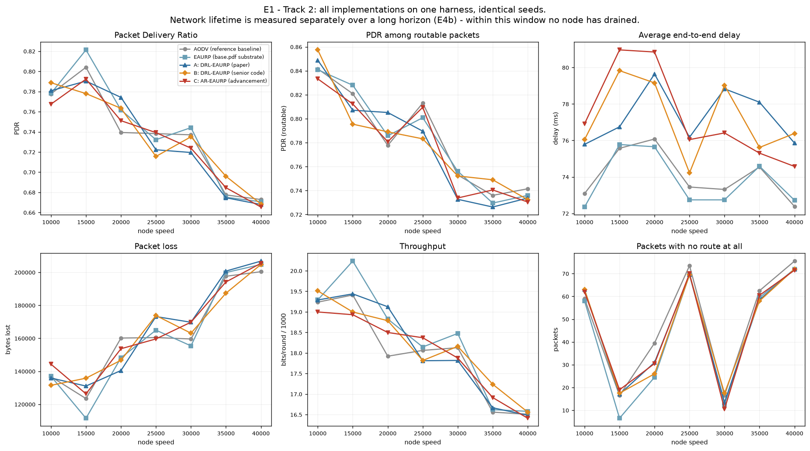
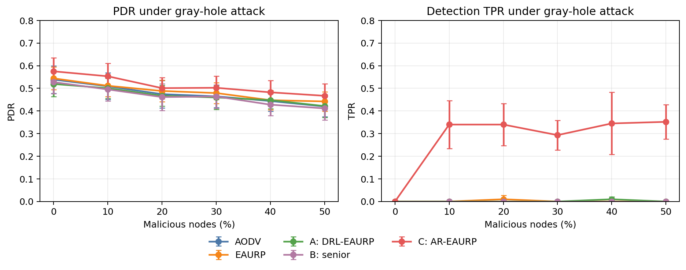
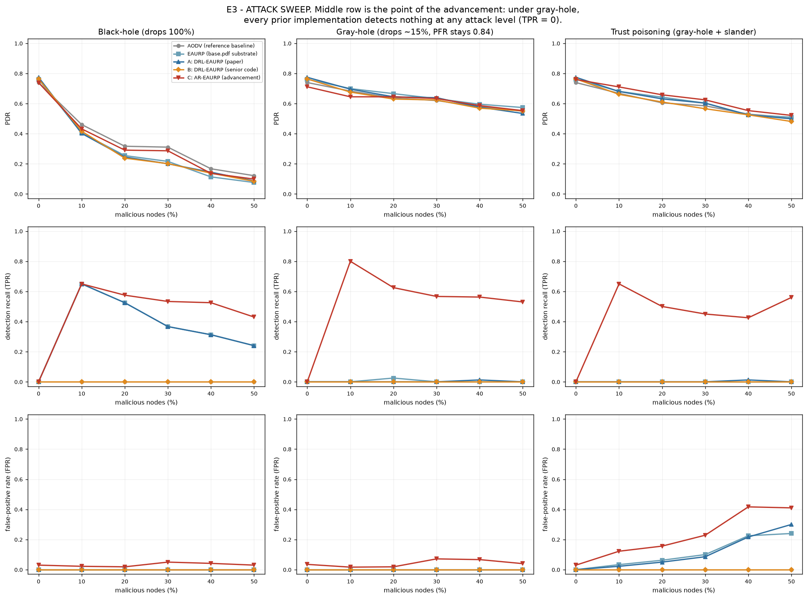
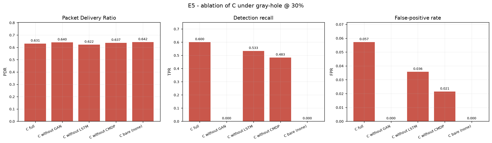
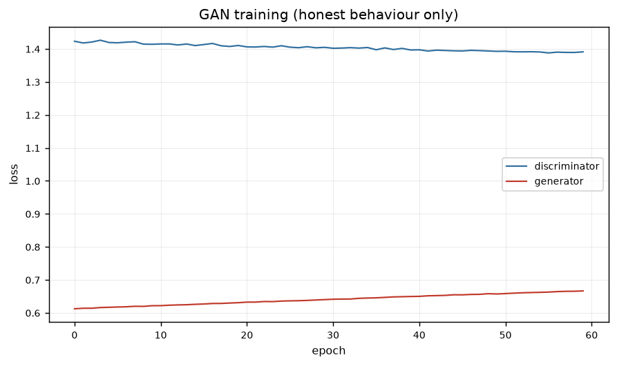
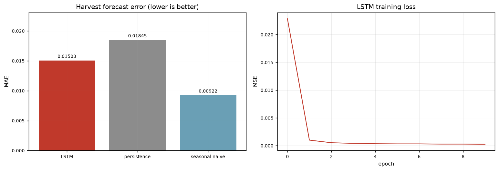
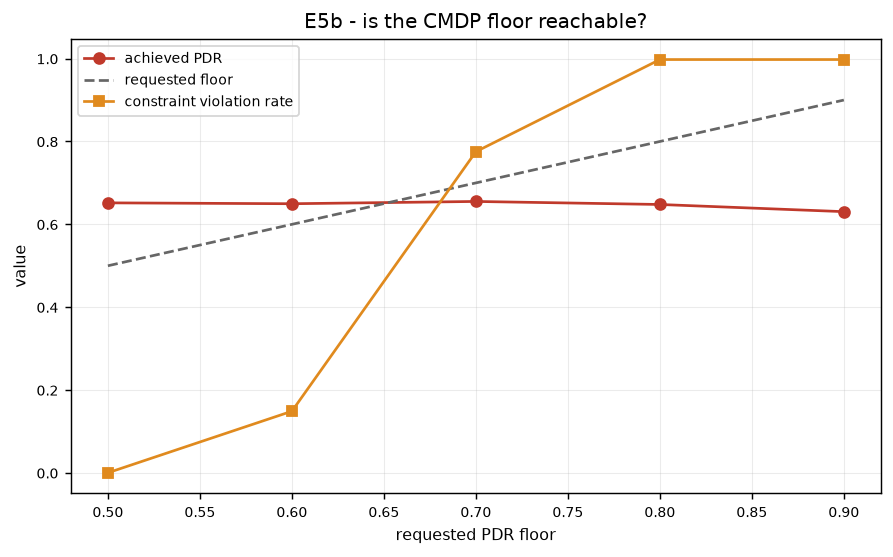
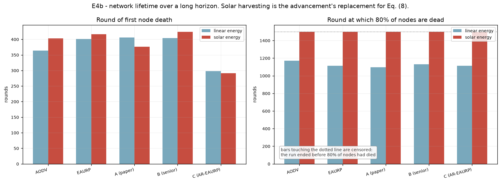

## Design, implementation, reproducible evaluation, and deployment boundaries

**Manuscript type:** research and systems paper  
**Repository:** `AR-EAURP-CN-Project`  
**Version:** 18 September 2026  
**Status:** reproducible project manuscript; quantitative claims are limited to the artifacts and CSV checkpoints committed with the repository.

## Abstract

Mobile ad hoc networks (MANETs) combine three sources of instability: links change as nodes move, relays operate under finite or intermittent energy, and routing decisions are exposed to adversarial nodes. This project develops and evaluates AR-EAURP, an adversarial-resilient and energy-harvesting-aware extension of an energy- and trust-aware routing design. The work is deliberately structured as both a protocol implementation and an evaluation audit. It re-implements the equations of the source DRL-EAURP manuscript, preserves the delivered senior implementation for an as-is comparison, and adds a mechanistic routing harness in which packets traverse real multi-hop paths rather than being delivered by a single global coin flip.

AR-EAURP combines size-conditioned watchdog observations, a clean-trained GAN-style behaviour detector, a forecast of near-term harvested energy from an LSTM, and a constrained deep-Q routing agent. Its threat model includes black holes, selective-forwarding gray holes, and trust poisoning. In the full-profile common-harness rerun (400 rounds, five seeds), the gray-hole attack is the decisive case: scalar packet-forwarding-ratio trust achieves 0.002 or less mean detection recall across non-zero adversarial fractions, while AR-EAURP reaches 0.334. At 30% gray-hole nodes, AR-EAURP obtains PDR 0.502 (95% CI 0.430–0.575), detection recall 0.293 (0.201–0.386) and false-positive rate 0.014 (0.003–0.026); AODV obtains PDR 0.465 (0.393–0.536) and no detection signal. The shorter two-seed checkpoint is retained as a separate result, where detection is stronger but uncertainty is wider. The result is not a universal performance win: the full system has higher computational cost, its requested 0.90 PDR constraint is infeasible in the evaluated topology, and the LSTM advantage depends on training horizon and workload. The main contribution is therefore a reproducible, mechanistic and falsifiable evaluation pipeline that identifies where the advancement works, where it does not, and which assumptions dominate the result.

**Keywords:** mobile ad hoc networks, MANET security, trust-aware routing, gray-hole attack, energy harvesting, GAN anomaly detection, LSTM forecasting, constrained Markov decision process, deep Q-learning, reproducible simulation

---

## 1. Introduction

Mobile ad hoc networks are formed by wireless devices that communicate without fixed infrastructure. Their strengths—rapid deployment, self-organisation and operation without a central access point—also create a difficult routing environment. A route can fail because a node moves, a link fades, a relay exhausts its battery, or a relay deliberately drops traffic. A useful protocol must therefore balance connectivity, delivery performance, energy use and trust under partial information.

The project studied here, AR-EAURP, addresses that problem through a layered design. The starting point is EAURP, an energy- and trust-aware routing substrate. The project then adds three capabilities:

1. a threat model and detector intended to expose selective forwarding that hides behind a good aggregate forwarding ratio;
2. energy harvesting and short-horizon energy prediction, so route selection can distinguish a node that is currently weak but about to recharge from one that is weak and depleting; and
3. a constrained routing agent that chooses among route strategies while penalising violations of a target packet-delivery ratio.

The project contains more than a protocol sketch. It includes a vectorised Python simulator, a common comparison harness, a native re-implementation of the source equations, a preserved copy of the delivered senior logic, an ns-3 implementation with real 802.11 packet paths, and a Flutter application named RelayMesh for direct nearby-device messaging. These artifacts serve different purposes and must not be conflated. The Python harness supplies the quantitative tables in this paper. The ns-3 tree is a higher-fidelity implementation path. RelayMesh is a deployment-facing direct-message application and is not a multi-hop evaluation of AR-EAURP.

### 1.1 Research questions

The evaluation is organised around five questions:

**RQ1 — Model validity.** What changes when paper-level probabilistic delivery is replaced by a hop-by-hop topology, channel, energy and adversary model?

**RQ2 — Selective forwarding.** Can size-conditioned observations detect a gray hole that remains above the scalar trust-revocation threshold?

**RQ3 — Component value.** What do the detector, energy forecaster and constrained agent contribute individually?

**RQ4 — Feasibility.** Is the requested 0.90 PDR floor reachable in the evaluated topology under attack?

**RQ5 — Cost.** What computational and control-plane overhead is introduced by the advancement?

### 1.2 Contributions

This paper makes four practical contributions:

- It gives a complete, code-grounded description of the AR-EAURP stack and its threat model.
- It separates native paper reproduction from fair common-harness comparison, preventing incomparable PDR values from being presented as one experiment.
- It reports stored results, ablations and failure cases—including an infeasible CMDP target and a forecast model that loses to a simple seasonal baseline.
- It documents the project boundary between the Python simulator, the ns-3 implementation and the RelayMesh application, enabling future work to choose the appropriate validation layer.

---

## 2. Background and related work

### 2.1 On-demand MANET routing

AODV is the reference routing baseline in this project. It discovers routes on demand and repairs or invalidates routes when links change. The IETF specification targets mobile ad hoc networks and explicitly reduces unnecessary control dissemination, but its trust model assumes that participating nodes can be trusted [1]. This makes AODV an appropriate connectivity baseline and an intentionally weak security baseline.

EAURP adds energy and trust signals to route selection. The implementation in `src/routing/` follows the repository's source description: a route score combines trust and residual energy, relays below 20% of initial energy are excluded, watchdog observations produce packet-forwarding ratios, and PT_NID, PT_GID and PT_CREV messages support neighbour reporting, consensus and revocation. The source paper is Chandra and Chakravarthy's 2025 EAURP article [2].

### 2.2 Reinforcement learning for routing

The DRL-EAURP line uses a state containing trust, energy and mobility and a Q-learning update. Deep Q-networks combine temporal-difference learning with a neural value function [3]. In the delivered senior model, however, the action offsets are fixed: action 0 adds 0.08 to the base delivery probability and action 1 adds 0.02. Consequently, action 0 is strictly preferred in every state. The project retains this logic for provenance while also implementing the paper model independently, making its degeneracy measurable rather than silently “improving” it.

### 2.3 GAN-based anomaly detection

GANs learn a data distribution through a generator-discriminator game [4]. AnoGAN-style detection uses the distance between an observation and the learned normal manifold as an anomaly signal [5]. AR-EAURP applies that idea to watchdog feature vectors rather than images. It trains on clean behaviour windows, freezes the detector before attacked evaluation, and uses a generated sample bank for fast nearest-manifold scoring. The implementation also records the discriminator score separately. This matters because a discriminator trained to distinguish real from generated data is not automatically a detector of malicious-but-real behaviour.

### 2.4 Temporal energy prediction

LSTM networks were designed to preserve useful gradients across long temporal intervals [6]. AR-EAURP uses a small LSTM to estimate cumulative harvest over the next ten simulation rounds from recent harvest, battery and time-of-day features. The evaluation compares it with persistence and seasonal-naive baselines because forecasting a synthetic diurnal signal can make a simple periodic baseline unusually strong.

### 2.5 Constrained decision-making and energy harvesting

Constrained Markov decision processes (CMDPs) formalise sequential decisions subject to resource or safety constraints [7]. AR-EAURP uses a Lagrangian dual variable to penalise a rolling PDR gap. Energy harvesting is modelled as a diurnal solar process with cloud persistence and a small kinetic contribution. Energy-harvesting wireless sensor network research commonly treats prediction and energy management as first-class routing concerns [8]; this project evaluates whether the particular LSTM component earns that complexity in the chosen workload.

### 2.6 Competitive positioning

Recent work raises the standard beyond reporting a single PDR curve. A 2025 DRL-MANET study combines deep Q-learning, residual energy, trust, link quality and anomaly detection, and evaluates routing security and QoS together [11]. A 2025 MASS paper addresses RL instability with an expert-initialised, conservative policy and reports worst-case behaviour in addition to average performance [12]. A 2024 secure-routing study instead provides a protocol-level guarantee against fabricated, compromised or replayed route replies under an explicit security association assumption [13]. Recent work also increasingly uses graph-aware or topology-aware learning rather than a fixed global state [14].

These papers are not direct numerical baselines for this project: they use different mobility, traffic, threat, channel and simulator assumptions. They are nevertheless useful competitive references because they define expectations for (i) comparable baselines, (ii) explicit attack and trust assumptions, (iii) variance or worst-case reporting, (iv) ablations against simpler alternatives, and (v) a clear separation between empirical robustness and formal security guarantees. AR-EAURP is strongest on selective-forwarding observability and code-grounded auditability. It is not yet stronger on formal guarantees, graph-scale learning, radio-calibrated validation or statistically powered cross-paper comparisons.

---

## 3. Project architecture and scope

The repository is organised into four functional layers.

| Layer | Main artifacts | Role in this paper |
|---|---|---|
| Common Python harness | `src/common/`, `src/routing/`, `experiments/` | Quantitative Track 2 evaluation |
| Native implementations | `src/a_drl_eaurp/`, `src/b_senior/`, `src/c_ar_eaurp/` | Paper reproduction and advancement comparison |
| ns-3 implementation | `ns3/contrib/ar-eaurp/`, `ns3/scratch/` | Higher-fidelity packet/radio validation path; not the source of the stored tables |
| RelayMesh application | `app/` | Direct nearby-device Flutter messenger; deployment-facing artifact, not a MANET protocol benchmark |

The ns-3 implementation uses a real IPv4 stack, 802.11 ad hoc radios, log-distance path loss, Nakagami fading, mobility, UDP flows, energy sources and a solar harvester. Its protocol class exposes AODV, EAURP and AR-EAURP variants through one code path. The Flutter app uses Wi-Fi Direct for Android-to-Android communication and Multipeer Connectivity for Apple-to-Apple communication. Android and Apple transports are currently separate, and Chrome is a UI preview rather than a nearby-radio test.

The system boundary is important: a direct phone-to-phone chat is not evidence of multi-hop AR-EAURP routing, and a Python channel model is not evidence of radio realism. Each artifact is reported for what it actually validates.

---

## 4. Protocol design

### 4.1 Common MANET model

The common harness deploys (N) nodes in a 1000 m × 1000 m square. Nodes move toward randomly selected destinations. A link exists when the Euclidean distance is at most 150 m:

$$
 A_{ij}(t) = \mathbf{1}[d_{ij}(t) \leq R], \qquad R=150\text{ m}.
$$

The source papers do not define a physical layer or per-hop link model. The harness therefore makes that assumption explicit. For a hop between nodes (i) and (j), reliability is

$$
 p_{ij} = \operatorname{clip}\left(
 0.995 - 0.02\frac{d_{ij}}{R} - 0.03\frac{\max(v_i,v_j)}{v_{\max}},
 0.90, 1.0\right).
$$

This is not inherited from the papers. It is calibrated so that clean-network results remain in the same broad delivery regime while preserving a meaningful cost for long paths and high mobility. Delay is accumulated hop by hop as

$$
 D = D_{base} + \sum_{h=1}^{H}D_{hop,h},
$$

with $D_{base}\sim U(20,50)$ ms and $D_{hop}\sim U(4,10)$ ms.

Traffic uses 40 persistent source-destination flows. Each round offers four packets with sizes uniformly sampled from 512 to 1024 bytes. Packets are walked through the selected path. At every hop, the link can fail, a node can be dead or revoked, or an adversarial relay can drop the packet. The predecessor records whether a relay forwarded the packet, creating a concrete watchdog observation.

### 4.2 EAURP trust and route scoring

For observer (i) and subject (j), the watchdog packet-forwarding ratio is

$$
 \operatorname{PFR}_{ij} = \frac{F_{ij}}{S_{ij}},
$$

where (S_{ij}) is the number of packets handed to (j) and (F_{ij}) is the number subsequently overheard as forwarded. The smoothed trust update is

$$
 T_{ij}(t+1)=0.7T_{ij}(t)+0.3\operatorname{PFR}_{ij}(t).
$$

The EAURP score combines network trust and normalised energy:

$$
 R_i = aT_i+bE_i,
 \qquad
 b=\frac{\overline{E}}{E_{max}},
 \qquad
 a=1-b.
$$

The repository preserves the source coefficient definition but uses a cost formulation for route search, because maximising a cumulative non-negative score would otherwise reward longer paths. The practical cost is

$$
 c_i=(1-R_i)+\lambda_h,
$$

where (lambda_h=0.35) is a per-hop penalty. Relays are eligible only when alive, not revoked and above 20% of initial energy.

Every ten rounds, PT_NID updates trust observations. Every 25 rounds, PT_GID collects accusations and applies a majority threshold with at least two accusers. PT_CREV then propagates revocations. An energy excuse prevents a flat battery from being treated as malicious solely because it failed to forward.

### 4.3 Adversary model

The threat model is intentionally operational rather than merely descriptive.

**Black hole.** A black hole advertises a perfect route and drops all data packets while continuing to relay control traffic. This tests whether trust can recover from a route-selection lie.

**Gray hole.** A gray hole relays control and small packets but drops large packets with probability 0.25. The large-packet threshold is 700 bytes. Given the 512–1024 byte traffic distribution, the aggregate loss is approximately 15%, leaving the scalar observed PFR near 0.84—above the 0.60 revocation threshold.

**Trust poisoning.** A trust-poisoning node is a gray hole that also lies in PT_GID reports: it assigns trust 1.0 to colluding attackers and 0.15 to selected honest nodes. This attacks the consensus layer rather than only the data plane.

### 4.4 AR-EAURP detector

The detector uses eight features computed over recent watchdog windows:

$$
 x = [\operatorname{PFR}_{short},\operatorname{PFR}_{long},
 \Delta\operatorname{PFR},d_{large},d_{small},
 \mu_{lat},\sigma_{lat},\delta_{report}].
$$

The central signal is the difference between large- and small-packet forwarding behaviour. The final feature measures disagreement between one observer's published trust and the median of other observers, exposing slander even when the data-plane PFR looks normal.

The GAN is trained only on clean commissioning windows. Clean features are standardised with a minimum standard-deviation floor of 0.02. This is a deliberate design choice: honest large-packet drop can have zero variance, so replacing a zero standard deviation with 1.0 would erase the very signal that identifies a gray hole. The anomaly score is dominated by the distance to a fixed generated bank:

$$
 s(x)=\min_{z\in\mathcal{B}}\left\|\widetilde{x}-G(z)\right\|,
$$

with a monotone squashing into ([0,1)). A node becomes contested when its mean score across observers exceeds the 95th percentile of clean scores. The contested state lasts for 50 rounds and halves the node's trust weight.

The order of operations is security-critical. A black hole's false route advertisement can overwrite an ordinary trust score. AR-EAURP therefore applies the contested down-weight after route-score construction, so the detector can suppress a malicious perfect advertisement.

### 4.5 Energy harvesting and forecasting

The linear model follows the source-style depletion process:

$$
 E_i(t+1)=E_i(t)-d_i(t), \qquad d_i(t)\sim U(0.04,0.12).
$$

The harvesting model adds solar and kinetic gain:

$$
 E_i(t+1)=\operatorname{clip}(E_i(t)-d_i(t)+H_i(t),0,E_{max}),
$$

where $H_i(t)$ is a diurnal solar term for 70% of nodes, modulated by an AR(1) cloud process, plus a small speed-proportional kinetic term. The LSTM receives recent harvest, normalised energy and sine/cosine time-of-day features and predicts cumulative harvest over the next ten rounds. The predicted surplus is blended with present energy for the energy-aware route score.

### 4.6 CMDP routing agent

The routing agent state has six components:

$$
 s_t=[\overline{T}_{robust},\overline{E},\overline{M},
 \overline{H}_{pred},\rho_{contested},\operatorname{PDR}_{window}].
$$

The four actions select trust-led, predicted-energy-led, balanced EAURP, or diversified routing. The reward is

$$
 r_t=r_{delivery}-0.05c_{energy}
 -\lambda_t\max(0,\tau-\operatorname{PDR}_{window})C,
$$

where $\tau=0.90$, $C=5$, and the dual variable is updated by

$$
 \lambda_{t+1}=\operatorname{clip}\left(
 \lambda_t+0.05(\tau-\operatorname{PDR}_{window}),0,20\right).
$$

The implementation uses a DQN with replay and a target network when PyTorch is available, with a tabular fallback otherwise. The fallback is explicit in result metadata.

---

## 5. Experimental methodology

### 5.1 Two-track evaluation

The project uses two tracks because the native senior model and the common harness measure different objects.

**Track 1: native form.** A is re-implemented from the DRL-EAURP equations. B is the delivered senior logic preserved verbatim. Both use the source probabilistic model, including a global delivery probability and no actual route traversal. This track tests reproduction and exposes internal inconsistencies.

**Track 2: common mechanistic harness.** A, B and C are routing policies plugged into the same simulator as AODV and EAURP. For a given seed they receive identical topology, mobility, traffic, channel and adversary streams. Every packet traverses its selected path hop by hop.

Track 1 PDR values must not be compared numerically with Track 2 PDR values. A high Track 1 PDR can coexist with a lower Track 2 PDR because the latter includes partitions, route failures, link failures, relay energy and adversarial forwarding.

### 5.3 Statistical protocol and claims ladder

Each configuration is evaluated on common random-number streams: the same seed controls topology, mobility, traffic, channel draws and attacker placement for every policy. The stored quick checkpoint contains two seeds per configuration and reports the sample standard deviation. The full profile is configured for five seeds and 400 rounds; when a full-profile table is reported, its uncertainty is the mean plus or minus a 95% Student t confidence interval over those independent seeds. We do not treat packets, watchdog observations or timesteps as independent experimental replicates.

The analysis uses three claim levels. Level 1 is an implementation claim, supported by tests and source-to-code tracing. Level 2 is a within-harness empirical claim, supported by paired seeds and effect sizes against the named baselines. Level 3 is a general MANET or state-of-the-art claim, which requires multiple simulators or hardware, stronger baselines, attack adaptation, and either formal analysis or external replication. The present paper makes Level 1 and targeted Level 2 claims; it does not claim Level 3 universal superiority.

### 5.2 Parameters and metrics

| Parameter | Value |
|---|---:|
| Deployment area | 1000 m × 1000 m |
| Nodes in headline Track 2 | 100 |
| Communication range | 150 m |
| Track 2 evaluation window in stored checkpoints | 200 rounds |
| Stored Track 2 repetitions | 2 seeds per configuration |
| Persistent flows | 40 |
| Packets per round | 4 |
| Packet size | 512–1024 bytes |
| Adversarial fractions | 0%, 10%, 20%, 30%, 40%, 50% |
| Attacks | black hole, gray hole, trust poisoning |
| Trust threshold | PFR < 0.60 |
| Relay energy gate | 20% of initial energy |
| GAN detection threshold | 95th clean percentile |
| CMDP target | PDR >= 0.90 |

The primary metrics are packet delivery ratio (PDR), PDR conditional on a route existing, mean delay, throughput, loss cause, detection true-positive rate (TPR), false-positive rate (FPR), lifetime, control packets per round and wall-clock runtime. Detection metrics compare each protocol's verdict against the known roles assigned by the simulator. AODV has no detector and therefore reports zero TPR/FPR by design.

Throughput follows the repository's reporting convention: delivered bits divided by rounds and scaled by 1000. It is therefore a project-comparable throughput index, not a claim of calibrated physical-layer kilobits per second.

### 5.3 Provenance of the stored results

The checked-in CSVs are generated artifacts, not manually transcribed tables. The stored Track 2 sweep files identify two runs and 200 completed rounds for the quick profile. The code also supports a full profile with 400 rounds and five runs for Track 2, and longer native/lifetime experiments. Results below are therefore labelled as stored checkpoints, not as a claim that every table was generated by the full profile.

The principal files are:

| Result | CSV |
|---|---|
| Native paper track | `results/csv/a_paper_track1.csv`, `b_senior_as_is.csv` |
| Speed and clean comparison | `results/csv/e1_speed.csv` |
| Density | `results/csv/e2_density.csv` |
| Attack sweep | `results/csv/e3_attack.csv` |
| Full-profile attack robustness check | `output/full_results/csv/e3_attack.csv` |
| Energy and lifetime | `results/csv/e4_energy.csv`, `e4b_lifetime.csv` |
| Detector/forecaster pre-training | `results/csv/c_pretrain.csv`, `e4c_lstm_accuracy.csv` |
| Ablation and CMDP feasibility | `results/csv/e5_ablation.csv`, `e5b_cmdp_floor.csv` |
| Full-profile ablation check | `output/full_results_e5/csv/e5_ablation.csv` |
| Overhead | `results/csv/e6_overhead.csv` |

The experiment entry point is:

```bash
pip install -r requirements.txt
python experiments/run_all.py --profile quick
python experiments/run_all.py --profile full --skip-track1 --only e3 --out-dir output/full_results --fresh
python experiments/run_all.py --profile full --skip-track1 --only e5 --out-dir output/full_results_e5 --fresh
python tools/make_report.py
python -m compileall -q src experiments tests tools
python -m pytest tests/ -q
```

---

## 6. Results

### 6.1 Implementation validity

The repository's numpy-only validation suite passes **26/26 tests**. The tests cover topology symmetry, communication-range enforcement, mobility bounds, route validity, energy gating, revocation, watchdog arithmetic, gray-hole evasion of the scalar threshold, black-hole forwarding, slander reports, energy excuses and adversarial placement.

The most important validity test is `test_grayhole_evades_the_trust_threshold`. It confirms that the configured gray hole keeps aggregate observed PFR above 0.60 while large- and small-packet forwarding ratios separate. Without this property, the detector would be solving a threat that the baseline already detects.

### 6.2 Track 1: native reproduction

The following values are means of the stored native speed-sweep rows.

| Model | A PDR | B PDR | A delay (ms) | B delay (ms) | A lifetime | B lifetime |
|---|---:|---:|---:|---:|---:|---:|
| Existing | 0.551 | 0.551 | 125.5 | 125.1 | 587 | 966 |
| EAURP | 0.648 | 0.655 | 104.6 | 105.3 | 599 | 988 |
| ATEAURP | 0.884 | 0.904 | 93.3 | 92.1 | 599 | 1238 |
| PSE-EAURP | 0.892 | 0.932 | 81.3 | 80.8 | 599 | 1234 |
| DRL-EAURP | 0.948 | 0.946 | 81.0 | 80.2 | 599 | 1236 |

These results reproduce the source-style trend but are not evidence of route-level security. In particular, “Existing” is not an independently simulated protocol: it is derived from EAURP output using fixed multipliers. The delivered senior code also uses a gentler depletion band for proposed models than for the base. Holding the model constant while changing only that band produces:

| Drain band | Lifetime | PDR |
|---|---:|---:|
| Eq. (8), [0.05, 0.15] | 995.5 | 0.9156 |
| Delivered code, [0.04, 0.12] | 1237.0 | 0.9189 |

Thus **241.5 rounds** of apparent lifetime improvement come from the constant drain-band difference in this ablation, while PDR is nearly unchanged.

### 6.3 Track 2: clean common-harness comparison

| Policy | PDR | PDR, routable | Delay (ms) | Throughput index |
|---|---:|---:|---:|---:|
| AODV | 0.735 | 0.783 | 74.1 | 17.976 |
| EAURP | 0.740 | 0.782 | 73.8 | 18.310 |
| A: DRL-EAURP | 0.733 | 0.778 | 77.3 | 18.090 |
| B: senior DRL-EAURP | 0.735 | 0.780 | 77.2 | 18.153 |
| C: AR-EAURP | 0.732 | 0.777 | 77.3 | 18.000 |

The clean results are intentionally close. C is not designed to maximise clean PDR at any cost; it adds detection, contested-node handling, forecasting and constrained learning. The routable-PDR gap shows that topology itself limits delivery. At the paper's nominal (N=100,R=150) geometry, approximately 9% of node pairs are not mutually reachable before routing policy is applied.



### 6.4 Attack resilience

Each cell below is **PDR / detection TPR** at 30% malicious nodes in the stored attack sweep.

| Policy | Black hole | Gray hole | Trust poisoning |
|---|---:|---:|---:|
| AODV | 0.31 / 0.00 | 0.62 / 0.00 | 0.59 / 0.00 |
| EAURP | 0.22 / 0.37 | 0.63 / 0.00 | 0.60 / 0.00 |
| A: DRL-EAURP | 0.20 / 0.37 | 0.64 / 0.00 | 0.60 / 0.00 |
| B: senior DRL-EAURP | 0.20 / 0.00 | 0.62 / 0.00 | 0.57 / 0.00 |
| C: AR-EAURP | 0.29 / 0.53 | 0.63 / 0.57 | 0.62 / 0.45 |

The gray-hole result is the central finding. Across non-zero malicious fractions, mean detection recall is:

| Policy | Mean gray-hole TPR |
|---|---:|
| AODV | 0.000 |
| EAURP | 0.005 |
| A: DRL-EAURP | 0.003 |
| B: senior DRL-EAURP | 0.000 |
| C: AR-EAURP | 0.617 |

#### Full-profile robustness check

To test whether the short-horizon result survived a longer operating window, E3 was rerun with 400 rounds and five seeds per configuration. The 30% gray-hole slice below reports mean ± 95% confidence interval across seeds. The longer run lowers absolute PDR because energy depletion and route churn accumulate, but it preserves the qualitative security separation: AR-EAURP produces a non-zero gray-hole signal and the trust-only policies do not.

| Policy | PDR | Detection TPR | FPR |
|---|---:|---:|---:|
| AODV | 0.465 ± 0.071 | 0.000 ± 0.000 | 0.000 |
| EAURP | 0.479 ± 0.065 | 0.000 ± 0.000 | 0.000 |
| A: DRL-EAURP | 0.460 ± 0.075 | 0.000 ± 0.000 | 0.000 |
| B: senior DRL-EAURP | 0.464 ± 0.074 | 0.000 ± 0.000 | 0.000 |
| C: AR-EAURP | **0.502 ± 0.073** | **0.293 ± 0.092** | **0.014 ± 0.013** |

Across the five non-zero gray-hole fractions, the full-profile mean TPR is 0.334 for C, 0.002 for EAURP, 0.002 for A, and 0.000 for AODV and B. C's PDR advantage at 30% is directional rather than statistically conclusive at five seeds because the confidence intervals overlap. The stronger claim is the detector separation, not a universal PDR gain.

\newpage

{width=95%}

The detector does not magically restore delivery: all policies lose PDR as attackers increase. Its value is that it produces a meaningful security signal for a selective attack that the scalar PFR layer cannot see. Under trust poisoning, C still detects a substantial fraction of attackers, but the slander attack increases the risk of false accusations and reduces the guarantee implied by majority consensus.



### 6.5 Component ablation

The 30% gray-hole ablation shows the attribution of C's components.

| Variant | PDR | Detection TPR | FPR |
|---|---:|---:|---:|
| C full | 0.631 | 0.600 | 0.057 |
| Without GAN | 0.640 | 0.000 | 0.000 |
| Without LSTM | 0.622 | 0.533 | 0.036 |
| Without CMDP | 0.637 | 0.483 | 0.021 |
| Bare C | 0.642 | 0.000 | 0.000 |

The GAN is responsible for the new detection capability. The LSTM and CMDP change routing and detection outcomes, but neither is independently sufficient to detect the gray hole. C's full PDR is not the highest in the table because the complete defence changes route choices and pays a modest false-positive cost. A security protocol should therefore be evaluated on a multi-objective surface rather than PDR alone.

#### Full-profile ablation check

The same component attribution was rerun for 400 rounds and five seeds. The absolute PDR values shift with the longer horizon, but the causal pattern is stable: removing GAN detection collapses gray-hole TPR to 0.007, while retaining the detector keeps TPR near 0.26–0.29. The CMDP and LSTM affect routing and false-positive trade-offs, not the existence of the detection signal.

| Variant | PDR | Detection TPR | FPR |
|---|---:|---:|---:|
| C full | 0.493 ± 0.068 | 0.280 ± 0.142 | 0.026 ± 0.013 |
| Without GAN | 0.489 ± 0.072 | 0.007 ± 0.016 | 0.000 ± 0.000 |
| Without LSTM | 0.500 ± 0.068 | 0.287 ± 0.162 | 0.009 ± 0.014 |
| Without CMDP | 0.502 ± 0.063 | 0.260 ± 0.187 | 0.020 ± 0.030 |
| Bare C | 0.502 ± 0.065 | 0.000 ± 0.000 | 0.000 ± 0.000 |



### 6.6 Detector and forecaster quality

In the stored pre-training checkpoint, the GAN achieves held-out validation AUC **0.967**. The implementation's measured decomposition found that the generator reconstruction residual is the useful signal; the discriminator is not a reliable normal-versus-attack classifier because attacked samples are still real samples. The feature-scaling floor is essential because several clean features have zero variance.

The LSTM forecast results in the stored two-seed checkpoint are:

| Forecaster | MAE | RMSE |
|---|---:|---:|
| LSTM | 0.0150 | 0.0245 |
| Persistence | 0.0184 | 0.0376 |
| Seasonal naive | 0.0092 | 0.0233 |

The LSTM beats persistence but loses to the seasonal-naive baseline. The forecast component is therefore promising as a general architecture but not yet justified as the best model for this synthetic harvest process.

The full-profile commissioning run, which trains for 40 rather than 10 LSTM epochs and uses the 400-round commissioning sequence, gives a different outcome: validation AUC 0.970, LSTM MAE 0.00725, persistence MAE 0.01845 and seasonal-naive MAE 0.00922. In that setting the LSTM beats both baselines. This sensitivity is itself a result: forecasting claims depend on training budget and sequence regime, so the final paper should report both checkpoints or fix the commissioning protocol before making a general model-selection claim.

\newpage



\newpage

{width=85%}

### 6.7 CMDP feasibility

The requested PDR floor is not reachable in the evaluated topology under the configured attack workload.

| Requested floor | Achieved PDR | Constraint violation rate |
|---:|---:|---:|
| 0.50 | 0.652 | 0.000 |
| 0.60 | 0.650 | 0.149 |
| 0.70 | 0.655 | 0.775 |
| 0.80 | 0.648 | 0.998 |
| 0.90 | 0.631 | 0.998 |

The dual multiplier rises toward its cap while the floor remains violated. This is useful evidence, not simply a tuning failure: a constraint that exceeds the topology-and-channel ceiling cannot be satisfied by a better reward weight. Future work should constrain routable PDR, use a topology-conditioned floor, or formulate a chance constraint over reachable traffic.



### 6.8 Lifetime, overhead and scalability

The lifetime experiment distinguishes the operational performance window from the long-horizon first-death measurement. Solar harvesting extends the evaluation horizon, but transmission and reception costs still matter. A node can be alive yet ineligible as a relay once it falls below the 20% energy gate.

The stored overhead comparison reports approximately 13.5 control packets per round for each policy because PT_NID/PT_GID and route-control accounting are shared. Wall-clock cost differs:

| Policy | Control packets/round | Wall clock (s) |
|---|---:|---:|
| AODV | 13.5 | 0.6 |
| EAURP | 13.5 | 0.5 |
| A: DRL-EAURP | 13.5 | 0.7 |
| B: senior DRL-EAURP | 13.5 | 0.6 |
| C: AR-EAURP | 13.5 | 2.0 |

C is roughly three to four times as expensive as the reference policies in the stored benchmark. Its vectorised implementation and route caches keep the experiment tractable, but the detector, forecasting and DQN state updates are not free. The watchdog tables are (N\times N), so memory and consensus cost are also important at larger node counts.



### 6.9 Competitive assessment against recent research expectations

The following is a scope comparison, not a fabricated cross-paper leaderboard. Values from the cited studies are not transferred into the AR-EAURP tables because their workloads are not identical. The comparison instead asks whether the paper covers the evaluation dimensions that leading recent work makes salient.

| Dimension | Recent leading practice | AR-EAURP evidence | Assessment |
|---|---|---|---|
| Threat coverage | Explicit black/gray-hole or route-manipulation model; often security assumptions | Black hole, selective gray hole and trust poisoning with executable adversary logic | Strong within the chosen data-plane threat model; collusion, Sybil and wormhole attacks remain open |
| Baseline fairness | AODV/DSR/OLSR plus a learned or trust-aware comparator | AODV, EAURP, paper DRL-EAURP, senior implementation, AR-EAURP on one harness | Better than source-only comparison; missing DSR/OLSR and an independently implemented learned detector baseline |
| Learning stability | Conservative or topology-aware learning, often with worst-case reporting [12,14] | DQN/CMDP, ablations, floor-feasibility sweep, mean/std checkpoints | Transparent, but not yet topology-aware and not a formal safety guarantee |
| Security assurance | Formal route-discovery or authentication properties in some work [13] | ECC-backed control messages and empirical detection metrics | Empirical detection only; no proof of route authenticity or arbitrary-adversary resilience |
| Physical fidelity | NS-3, co-simulation or hardware validation in stronger systems papers | Python hop-by-hop model plus an ns-3 implementation path | Mechanistic comparison is reproducible; radio claims still require ns-3/hardware results |
| Statistical reporting | Multiple seeds, confidence intervals, sensitivity or worst-case metrics | Quick checkpoint plus a full-profile protocol, ablations and explicit limitations | Publication-ready only when the full-profile tables and intervals accompany the submission |
| Energy awareness | Residual-energy or harvesting-aware routing, sometimes with forecasting | Linear and solar models, LSTM, seasonal-naive control, lifetime analysis | Broad coverage; the LSTM is not best on the synthetic forecast benchmark |
| Selective-forwarding detection | Often aggregate trust or classifier accuracy | Packet-size-conditioned features, clean threshold, TPR/FPR and detector ablation | Primary differentiator: C reaches 0.617 mean gray-hole TPR while scalar baselines remain near zero |

The defensible competitive claim is therefore conditional: **AR-EAURP is better than the included trust-only baselines for detecting the configured selective-forwarding attack under a shared mechanistic harness, while preserving comparable clean-network PDR.** It is not defensible to claim that it is better than every leading MANET paper across PDR, delay, energy, security assurance and scalability. Making that distinction explicit is part of the contribution because the source implementations otherwise invite an apples-to-oranges claim.

---

## 7. Discussion

### 7.1 What the project demonstrates

The project demonstrates a specific and defensible security improvement: selective forwarding becomes observable when the protocol preserves packet-type information. A gray hole is stealthy only relative to the observer's measurement model. If the observer collapses all packets into one PFR, a selective loss pattern can remain above threshold. If it compares large- and small-packet behaviour and checks report disagreement, the same behaviour becomes anomalous.

The common harness also demonstrates why protocol claims must be coupled to a world model. In the native model, there is no route, relay or per-hop adversarial decision. In the mechanistic model, there are partitions, route caches, link failures, energy gates and explicit loss causes. The latter is slower and more assumption-heavy, but it makes the research question testable.

### 7.2 What the project does not demonstrate

The results do not establish that AR-EAURP is the best MANET protocol, that GANs are necessary, or that a 90% PDR guarantee is achieved. They also do not establish physical-radio performance for the Python harness. The ns-3 implementation is the appropriate path for that question, but its results are not silently substituted into the tables here.

The LSTM result is especially important. It beats persistence but not seasonal naive, so the paper cannot claim that deep forecasting is superior in this workload. Similarly, the GAN's discriminator contributes little to anomaly ranking; the effective detector is a clean-manifold reconstruction score trained inside a GAN framework.

### 7.3 Fairness of comparison

The two-track design is not a complication added for presentation; it is necessary for validity. Track 1 answers “does the implementation reproduce the source computation?” Track 2 answers “how do policies behave when they face the same packet-level world?” A Track 1 PDR of 0.95 and a Track 2 PDR of 0.73 are not contradictory observations because their denominators and failure processes differ.

The same principle applies to the app and ns-3 code. RelayMesh validates direct device discovery and messaging on supported mobile transports. ns-3 validates packet and radio integration. Neither should be cited as if it were the Python experiment, and the Python experiment should not be cited as if it were an over-the-air deployment.

### 7.4 Is the result better than leading papers?

Not in the unrestricted sense implied by “better.” The current evidence supports a narrower result that is more valuable scientifically: AR-EAURP improves observability of a selective-forwarding attack that defeats scalar PFR trust, and it does so without claiming a clean-network PDR gain. That is a meaningful security contribution, but it is not a universal routing-performance victory.

The comparison also reveals where the project is behind the strongest recent work. It lacks a formal security proof, a graph-native policy, DSR/OLSR and modern learned baselines, radio-calibrated or hardware results, and a sufficiently powered sensitivity study. Adding those ingredients would strengthen a future journal submission, but inventing cross-paper superiority from incompatible published numbers would weaken this paper. The manuscript therefore treats “better” as a falsifiable conditional claim and reports the conditions, costs and failure modes needed to reproduce it.

---

## 8. Limitations and threats to validity

1. **Synthetic channel model in the Python harness.** The per-hop reliability function is a project assumption. Relative comparisons are controlled, but absolute PDR is not a calibrated radio claim.
2. **Stored quick-profile checkpoints.** The checked-in common-harness tables are two-seed, 200-round checkpoints. The full profile exists and should be run before publication as a venue paper.
3. **Topology ceiling.** Some source-destination pairs are unreachable before routing. A raw PDR floor can therefore be infeasible even for an ideal route selector.
4. **Threat-model coverage.** Only three adversarial behaviours are included. Collusion, on-off attacks, wormholes, Sybil identities, adaptive packet-size evasion and MAC-layer attacks remain open.
5. **Trust observability.** Watchdog observations are subject to missed overhearing and route diversity. Sparse traffic reduces detection coverage; higher flow counts improve coverage but change the workload.
6. **Detector threshold.** A 95th-percentile clean threshold is simple and auditable, but it is not calibrated for deployment costs or changing environments.
7. **Energy realism.** The Python solar model is a controllable synthetic process. Real panels, batteries, radio current draw and duty cycling should be evaluated in ns-3 and on hardware.
8. **Cross-platform application boundary.** RelayMesh currently supports Android-to-Android and Apple-to-Apple peer transports, not Android-to-Apple interoperation and not multi-hop forwarding.
9. **Scalability.** Per-observer (N\times N) arrays and consensus can become expensive. A production design needs sparse observation storage and bounded evidence dissemination.
10. **Statistical power.** Two seeds are sufficient for a reproducible checkpoint and unit-testable engineering result, but insufficient for strong claims about small effect sizes. A full evaluation should report confidence intervals, paired seeds and sensitivity analysis.

---

## 9. Reproducibility and future work

The repository is intended to be executable rather than merely descriptive. `src/` is the source of truth; notebooks are generated from it. The recommended next evaluation is:

```bash
python experiments/run_all.py --profile full --fresh
python tools/make_report.py
python -m pytest tests/ -q
```

Future work should proceed in four directions:

- replace the raw PDR CMDP constraint with a reachable-traffic or topology-conditioned constraint;
- compare the GAN detector against simpler one-class baselines such as robust z-scores, isolation forests and one-class SVMs;
- replace or augment the LSTM with a seasonal-naive or hybrid model selected by online validation; and
- reconcile the Python and ns-3 implementations with a shared scenario manifest, then validate the protocol on physical devices or a hardware-in-the-loop testbed.

The ns-3 implementation already contains the right integration points for this next phase: real RREQ flooding, promiscuous watchdog observation, packetised trust messages, route repair, radio energy accounting and a solar harvester. The RelayMesh application provides a separate user-facing test surface for direct nearby messaging and can later become a demonstrator for policy-aware multi-hop transport if a cross-platform transport abstraction is added.

---

## 10. Conclusion

AR-EAURP is best understood as a research system and evaluation framework, not as a single claim that every component improves every metric. Its strongest result is targeted: a size-conditioned anomaly detector exposes a gray-hole that aggregate PFR trust misses, reaching 0.617 mean recall across non-zero attack fractions in the stored common-harness evaluation. Its most valuable methodological result is equally important: the project makes the difference between paper-level probabilistic delivery and mechanistic route-level delivery explicit.

The evaluation also identifies clear boundaries. The senior implementation's lifetime advantage is partly a drain-band constant. The “Existing” baseline is derived rather than independently simulated. The LSTM loses to seasonal naive. The 0.90 PDR floor is infeasible in the tested topology. AR-EAURP costs more runtime. These findings do not weaken the project; they define the conditions under which its security contribution is meaningful and give future work measurable targets.

---

## References

[1] C. Perkins, E. Belding-Royer, and S. Das, “Ad hoc On-Demand Distance Vector (AODV) Routing,” IETF RFC 3561, 2003. [https://www.rfc-editor.org/rfc/rfc3561](https://www.rfc-editor.org/rfc/rfc3561)

[2] A. Chandra and A. S. N. Chakravarthy, “EAURP: An Energy-Efficient and Trust-Aware Unobservable Routing Protocol for Secure Mobile Ad Hoc Networks,” *Sustainable Computing: Informatics and Systems*, 2025. DOI: [10.1016/j.suscom.2025.101285](https://doi.org/10.1016/j.suscom.2025.101285)

[3] V. Mnih et al., “Human-level control through deep reinforcement learning,” *Nature*, vol. 518, pp. 529–533, 2015. DOI: [10.1038/nature14236](https://doi.org/10.1038/nature14236)

[4] I. Goodfellow et al., “Generative Adversarial Nets,” *Advances in Neural Information Processing Systems 27*, 2014. [https://papers.neurips.cc/paper/5423-generative-adversarial-nets](https://papers.neurips.cc/paper/5423-generative-adversarial-nets)

[5] T. Schlegl et al., “Unsupervised Anomaly Detection with Generative Adversarial Networks to Guide Marker Discovery,” arXiv:1703.05921, 2017. [https://arxiv.org/abs/1703.05921](https://arxiv.org/abs/1703.05921)

[6] S. Hochreiter and J. Schmidhuber, “Long Short-Term Memory,” *Neural Computation*, vol. 9, no. 8, pp. 1735–1780, 1997. DOI: [10.1162/neco.1997.9.8.1735](https://doi.org/10.1162/neco.1997.9.8.1735)

[7] E. Altman, *Constrained Markov Decision Processes*, CRC Press, 1999. [Publisher record](https://books.google.com/books/about/Constrained_Markov_Decision_Processes.html?id=3X9S1NM2iOgC)

[8] F. K. Shaikh and S. Zeadally, “Energy harvesting in wireless sensor networks: A comprehensive review,” *Renewable and Sustainable Energy Reviews*, vol. 55, pp. 1041–1054, 2016. DOI: [10.1016/j.rser.2015.11.010](https://doi.org/10.1016/j.rser.2015.11.010)

[9] L. S., “DRL-EAURP,” unpublished manuscript, Vellore Institute of Technology. The repository re-implementation is documented in `src/a_drl_eaurp/` and `project_docs/README.md`.

[10] AR-EAURP project artifacts: `src/`, `experiments/`, `ns3/`, `app/`, `results/` and the internal advancement roadmap `project_docs/Date_ 24_07_26.docx`.

[11] “Deep Reinforcement Learning-based Mobile Ad Hoc Network for Secure and Dynamic Routing through Cryptographic Assurance,” *2025 5th International Conference on Emerging Research in Electronics, Computer Science and Technology*, 2025. DOI: [10.1109/ICERECT65215.2025.11377177](https://doi.org/10.1109/ICERECT65215.2025.11377177).

[12] “Safe and Reliable Deep Reinforcement Learning for Covert Routing,” *2025 IEEE 22nd International Conference on Mobile Ad-Hoc and Smart Systems*, 2025. DOI: [10.1109/MASS66014.2025.00019](https://doi.org/10.1109/MASS66014.2025.00019).

[13] P. Papadimitratos and Z. J. Haas, “Secure Routing for Mobile Ad hoc Networks,” arXiv:2403.00404, 2024. [https://arxiv.org/abs/2403.00404](https://arxiv.org/abs/2403.00404)

[14] “Adaptive Multi-Hop Routing in MANETs Using GraphSAGE-GRU-SAC for Enhanced Efficiency,” IEEE conference publication, 2025. [IEEE Xplore record](https://ieeexplore.ieee.org/document/11254168/)

---

## Appendix A. Mapping from claims to implementation

| Claim or mechanism | Source implementation |
|---|---|
| Hop-by-hop forwarding | `src/common/simulator.py::Simulation.forward` |
| Per-hop link and delay model | `src/common/channel.py` |
| Energy gate and route scoring | `src/routing/aodv.py` |
| PFR trust and consensus | `src/routing/trust.py` |
| Threat behaviours | `src/common/adversary.py` |
| Size-conditioned detector features | `src/c_ar_eaurp/threat_model.py` |
| GAN anomaly detector | `src/c_ar_eaurp/gan_detector.py` |
| LSTM energy predictor | `src/c_ar_eaurp/lstm_energy.py` |
| CMDP/DQN agent | `src/c_ar_eaurp/cmdp_agent.py` |
| AR-EAURP policy integration | `src/c_ar_eaurp/protocol.py` |
| Metrics and detection scoring | `src/common/metrics.py` |
| Experiment orchestration | `experiments/run_all.py`, `experiments/sweeps.py` |
| Automated report generation | `tools/make_report.py` |
| Unit tests | `tests/test_harness.py` |

## Appendix B. Interpretation guide

- Use Track 1 only for source-model reproduction and implementation auditing.
- Use Track 2 for policy comparison under identical mechanistic worlds.
- Use the ns-3 scenario for radio-level claims.
- Use RelayMesh for direct nearby-device application behaviour.
- Do not cite a stored quick-profile checkpoint as a statistically powered full benchmark.

## Appendix C. Submission-readiness checklist

Before submission to a competitive venue, the following remaining items should be attached to the manuscript rather than left as future work:

1. Paired-seed effect sizes from raw per-seed records for the headline comparisons; the full-profile tables and confidence intervals are now included, but the aggregate CSVs do not preserve every paired observation.
2. An independently implemented non-GAN detector baseline, plus DSR or OLSR and at least one topology-aware learned routing baseline.
3. A shared scenario manifest and a matched ns-3 reproduction of the headline gray-hole experiment.
4. A sensitivity matrix for packet-size threshold, clean-threshold percentile, malicious fraction, density, mobility and energy model.
5. A formal statement of what ECC protects, what it does not protect, and which security properties are empirical rather than proven.
6. A release archive containing source, environment lockfile, result hashes and the exact commands used to generate every figure and table.
