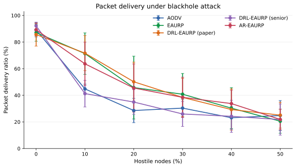
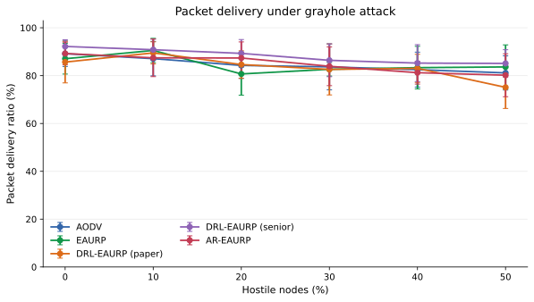
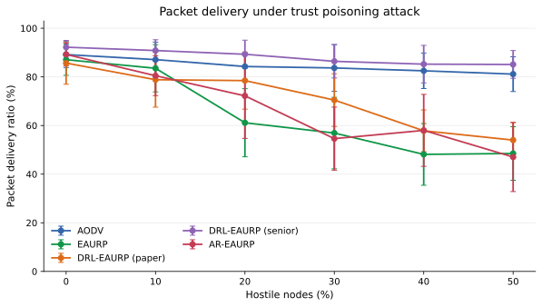
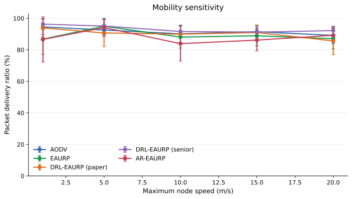
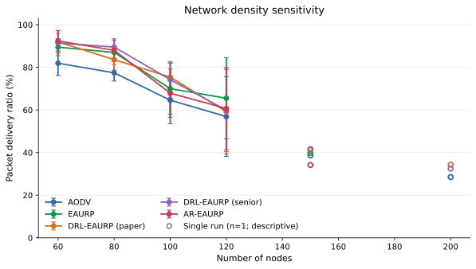
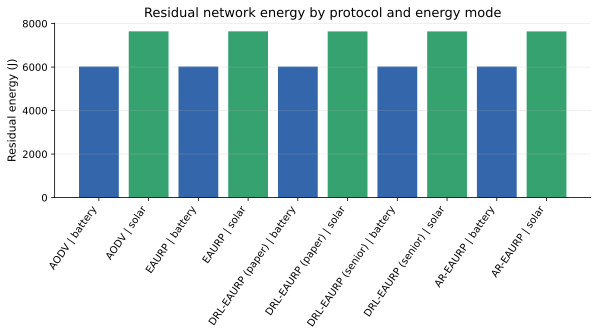
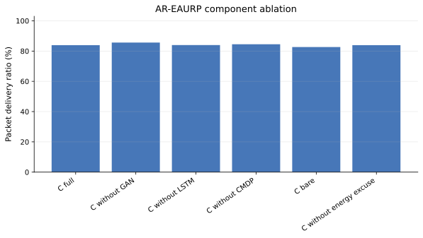

# Native ns-3 comparative evaluation

## Executive summary

This report summarizes the native ns-3.45 review matrix within the available time. The planned budget is five run numbers per condition with a fixed ns-3 seed of 20260909; the completion table records actual coverage, and incomplete replications are not imputed. The E3 attack sweep includes a paired AR-EAURP versus EAURP PDR analysis from the checksummed per-run checkpoints.

## Methods and reproducibility

Reproduction command from the project root: `bash ns3/scripts/run.sh --profile=review --only=e1,e2,e3,e4,e5,e6 --out=results/ns3-native-paper-review --render=0`. The experiment runner resumes only checksummed runs whose full parameter map and source/build identity match. Run `python generate_paper_report.py` from the result directory to rebuild the expanded settings ledgers and charts.

Execution provenance: this final E1–E6 report is assembled from verified native ns-3 run checkpoints. The root `manifest.json` selection field records the original C++ batch selection (`e3,e4,e5,e6`); E1 and the time-boxed E2 results were included from their verified checkpoint sets. The per-run ledger is the authoritative record of the 863 included runs.

## Simulation settings

Each row in `configuration_settings.csv` names the canonical run-1 CLI arguments and aggregate metrics for one condition, including the actual replicate count and run numbers. Each row in `run_settings.csv` records the exact CLI argument map for that completed run, simulator-reported cfg_* values, selected per-run metrics, and the SHA-256 of the checksummed raw checkpoint. Confidence intervals are omitted where fewer than two replications exist.

| Experiment | Factors varied | Conditions | Native runs |
|---|---|---:|---:|
| E1 mobility | 5 protocols × max speed 1, 5, 10, 15, 20 m/s | 25 | 125 |
| E2 density | 5 protocols × 60, 80, 100, 120, 150, 200 nodes | 30 | 150 |
| E3 attacks | 5 protocols × 3 attacks × 0–50% hostile nodes (10-point steps) | 90 | 450 |
| E4 energy | 5 protocols × battery/solar-kinetic harvesting | 10 | 50 |
| E4b lifetime | 5 protocols × battery/solar-kinetic harvesting, 900 s horizon | 10 | 50 |
| E5 ablation | 6 AR-EAURP component configurations | 6 | 30 |
| E5b CMDP floor | 0.70, 0.80, 0.90, 0.95 PDR constraints | 4 | 20 |
| E6 security overhead | 5 protocols plus AR-EAURP without ECC | 6 | 30 |

- Simulator: ns-3.45, native C++ source/build identity SHA-256 `45da34216e04a79d26b8e9db9e02270a2bcdb5c3edf8e63fea4d61eda8d9ed02`.
- Protocols: AODV, EAURP, DRL-EAURP (paper), DRL-EAURP (senior), AR-EAURP.
- Base review scenario: 24 nodes, six CBR flows, 420 m square area, 120 s evaluation, 20 s warm-up, 10 s cooldown.
- AR-EAURP clean commissioning: 240 s; GAN 120 epochs; LSTM 30 epochs. The CMDP route selector also learns during clean commissioning before attack evaluation.
- RNG: fixed seed 20260909 and run numbers 1–5 planned per condition. Run numbers are matched between protocol comparisons; results are stochastic replications, not repeated packets from one run.
- Metrics are reported as mean ± sample SD when at least two replications are present. Per-condition 95% confidence intervals use a two-sided Student t interval with degrees of freedom based on the observed sample size; bounded rate intervals (PDR, TPR, FPR, and AUC) are constrained to [0, 1]. E3 primary paired differences compare AR-EAURP and EAURP using corresponding run numbers.
- All ten pairwise protocol contrasts are retained for each E3 attack/prevalence condition in `pairwise_e3_comparisons.csv`; their intervals are unadjusted and should be interpreted as exploratory across this multiple-comparison family.
- `configuration_settings.csv` records each condition’s canonical run-1 CLI parameter map, observed run numbers, aggregate metrics, and simulator-reported settings. `run_settings.csv` records the exact CLI map for every completed run, measured cfg_* values, seed/run number, and the checksum of its raw checkpoint. Aggregate tables in `csv/` retain cfg_* means and sample SDs.

The review profile retains the Colab notebook’s E1–E6 factor levels but uses 120 s evaluation and the 24-node/six-flow review workload rather than the notebook full profile’s 400 s and larger default workload. The planned budget is five runs. Any time-boxed shortfall appears in the completion table; this is not a byte-for-byte rerun of the Colab full-profile configuration.

## Completion status

Completed 179 of 181 planned conditions and 863 of 905 planned native runs. The time-boxed E2 density sweep has missing replications; they are absent from the ledgers and are not imputed.

| Experiment | Completed conditions | Completed runs |
|---|---:|---:|
| e1_speed | 25/25 | 125/125 |
| e2_density | 28/30 | 108/150 |
| e3_attack | 90/90 | 450/450 |
| e4_energy | 10/10 | 50/50 |
| e4b_lifetime | 10/10 | 50/50 |
| e5_ablation | 6/6 | 30/30 |
| e5b_cmdp_floor | 4/4 | 20/20 |
| e6_overhead | 6/6 | 30/30 |

## E1 — Mobility

| Configuration | PDR | Delay (s) | Throughput (bit/s) |
|---|---|---|---|
| AODV @ 1 m/s | 94.53 ± 4.92 | 0.12 ± 0.10 | 34932.50 ± 1773.64 |
| AODV @ 5 m/s | 92.57 ± 3.41 | 0.12 ± 0.08 | 34212.93 ± 1181.96 |
| AODV @ 10 m/s | 90.13 ± 5.59 | 0.21 ± 0.10 | 33258.11 ± 2130.37 |
| AODV @ 15 m/s | 91.47 ± 2.22 | 0.21 ± 0.05 | 33777.76 ± 747.07 |
| AODV @ 20 m/s | 89.17 ± 5.34 | 0.24 ± 0.14 | 32930.64 ± 1999.54 |
| EAURP @ 1 m/s | 86.80 ± 9.64 | 0.10 ± 0.10 | 32071.52 ± 3523.84 |
| EAURP @ 5 m/s | 95.00 ± 4.99 | 0.18 ± 0.15 | 35081.84 ± 1894.53 |
| EAURP @ 10 m/s | 88.10 ± 7.01 | 0.23 ± 0.12 | 32486.45 ± 2707.45 |
| EAURP @ 15 m/s | 88.90 ± 6.38 | 0.30 ± 0.10 | 32870.02 ± 2304.32 |
| EAURP @ 20 m/s | 87.07 ± 6.41 | 0.29 ± 0.10 | 32138.88 ± 2366.01 |
| DRL-EAURP (paper) @ 1 m/s | 93.87 ± 5.78 | 0.09 ± 0.02 | 34676.83 ± 2041.94 |
| DRL-EAURP (paper) @ 5 m/s | 90.70 ± 8.69 | 0.19 ± 0.19 | 33476.00 ± 3202.31 |
| DRL-EAURP (paper) @ 10 m/s | 89.97 ± 5.21 | 0.24 ± 0.13 | 33172.64 ± 1953.22 |
| DRL-EAURP (paper) @ 15 m/s | 90.97 ± 4.89 | 0.30 ± 0.08 | 33570.30 ± 1859.21 |
| DRL-EAURP (paper) @ 20 m/s | 85.67 ± 8.71 | 0.28 ± 0.13 | 31650.02 ± 3159.78 |
| DRL-EAURP (senior) @ 1 m/s | 96.30 ± 3.57 | 0.12 ± 0.08 | 35571.57 ± 1307.86 |
| DRL-EAURP (senior) @ 5 m/s | 95.10 ± 4.18 | 0.14 ± 0.09 | 35086.50 ± 1611.90 |
| DRL-EAURP (senior) @ 10 m/s | 91.63 ± 3.48 | 0.19 ± 0.07 | 33805.54 ± 1327.14 |
| DRL-EAURP (senior) @ 15 m/s | 91.23 ± 3.54 | 0.22 ± 0.11 | 33687.44 ± 1365.07 |
| DRL-EAURP (senior) @ 20 m/s | 92.20 ± 2.78 | 0.28 ± 0.08 | 34059.62 ± 1042.92 |
| AR-EAURP @ 1 m/s | 86.60 ± 14.32 | 0.12 ± 0.14 | 31991.66 ± 5181.71 |
| AR-EAURP @ 5 m/s | 94.10 ± 5.56 | 0.19 ± 0.12 | 34783.52 ± 2094.29 |
| AR-EAURP @ 10 m/s | 83.93 ± 11.10 | 0.22 ± 0.09 | 30954.80 ± 4053.12 |
| AR-EAURP @ 15 m/s | 86.17 ± 6.90 | 0.31 ± 0.13 | 31847.71 ± 2513.57 |
| AR-EAURP @ 20 m/s | 89.23 ± 4.73 | 0.27 ± 0.06 | 32886.26 ± 1742.36 |

## E2 — Network density

Run count is shown for each condition. A single run is descriptive only and is not a replicated estimate; the settings ledgers show exact coverage.

| Configuration | Runs | PDR | Delay (s) | Throughput (bit/s) |
|---|---|---|---|---|
| AODV (reference baseline) @ N=60 | 5 | 81.93 ± 5.71 | 0.25 ± 0.13 | 30248.45 ± 2179.59 |
| EAURP (base substrate) @ N=60 | 5 | 89.47 ± 4.02 | 0.26 ± 0.06 | 32970.30 ± 1558.44 |
| A: DRL-EAURP (paper) @ N=60 | 5 | 92.00 ± 5.39 | 0.28 ± 0.04 | 33989.07 ± 1885.60 |
| B: DRL-EAURP (senior) @ N=60 | 5 | 91.40 ± 4.55 | 0.26 ± 0.05 | 33710.98 ± 1673.22 |
| C: AR-EAURP (advancement) @ N=60 | 5 | 92.40 ± 4.79 | 0.23 ± 0.07 | 34144.48 ± 1668.36 |
| AODV (reference baseline) @ N=80 | 5 | 77.43 ± 3.85 | 0.22 ± 0.07 | 28616.26 ± 1519.62 |
| EAURP (base substrate) @ N=80 | 5 | 87.03 ± 2.72 | 0.23 ± 0.03 | 32123.42 ± 1079.28 |
| A: DRL-EAURP (paper) @ N=80 | 5 | 83.60 ± 4.86 | 0.29 ± 0.06 | 30875.17 ± 1856.13 |
| B: DRL-EAURP (senior) @ N=80 | 5 | 89.53 ± 3.11 | 0.28 ± 0.06 | 33080.03 ± 1123.74 |
| C: AR-EAURP (advancement) @ N=80 | 5 | 88.00 ± 5.39 | 0.25 ± 0.05 | 32492.42 ± 1952.84 |
| AODV (reference baseline) @ N=100 | 5 | 64.60 ± 11.08 | 0.25 ± 0.01 | 23852.34 ± 4045.73 |
| EAURP (base substrate) @ N=100 | 5 | 70.00 ± 11.94 | 0.31 ± 0.07 | 25908.19 ± 4365.27 |
| A: DRL-EAURP (paper) @ N=100 | 5 | 75.40 ± 6.80 | 0.40 ± 0.11 | 27885.86 ± 2431.58 |
| B: DRL-EAURP (senior) @ N=100 | 5 | 74.23 ± 8.51 | 0.29 ± 0.04 | 27448.06 ± 3083.48 |
| C: AR-EAURP (advancement) @ N=100 | 5 | 67.87 ± 11.27 | 0.26 ± 0.07 | 25089.18 ± 4112.41 |
| AODV (reference baseline) @ N=120 | 5 | 56.90 ± 18.69 | 0.36 ± 0.16 | 21015.57 ± 6915.42 |
| EAURP (base substrate) @ N=120 | 5 | 65.50 ± 19.00 | 0.29 ± 0.10 | 24207.65 ± 6917.94 |
| A: DRL-EAURP (paper) @ N=120 | 5 | 59.20 ± 19.86 | 0.28 ± 0.14 | 21868.96 ± 7269.89 |
| B: DRL-EAURP (senior) @ N=120 | 5 | 59.83 ± 19.34 | 0.33 ± 0.17 | 22168.42 ± 7095.11 |
| C: AR-EAURP (advancement) @ N=120 | 5 | 60.70 ± 19.30 | 0.39 ± 0.20 | 22446.27 ± 7069.64 |
| AODV (reference baseline) @ N=150 | 1 | 38.67 (n=1) | 0.32 (n=1) | 14312.80 (n=1) |
| EAURP (base substrate) @ N=150 | 1 | 39.83 (n=1) | 0.35 (n=1) | 14856.24 (n=1) |
| A: DRL-EAURP (paper) @ N=150 | 1 | 41.17 (n=1) | 0.32 (n=1) | 15351.44 (n=1) |
| B: DRL-EAURP (senior) @ N=150 | 1 | 41.67 (n=1) | 0.38 (n=1) | 15483.04 (n=1) |
| C: AR-EAURP (advancement) @ N=150 | 1 | 34.17 (n=1) | 0.22 (n=1) | 12717.20 (n=1) |
| AODV (reference baseline) @ N=200 | 1 | 28.50 (n=1) | 0.12 (n=1) | 10568.80 (n=1) |
| A: DRL-EAURP (paper) @ N=200 | 1 | 34.33 (n=1) | 0.16 (n=1) | 12732.72 (n=1) |
| B: DRL-EAURP (senior) @ N=200 | 1 | 32.50 (n=1) | 0.21 (n=1) | 12058.00 (n=1) |

## E3 — Attack prevalence by protocol

PDR cells show mean ± sample SD across five run numbers; the table keeps attack types and hostile-node percentages separate.

### Blackhole

| Hostile nodes | AODV | EAURP | DRL-EAURP (paper) | DRL-EAURP (senior) | AR-EAURP |
|---:|---:|---:|---:|---:|---:|
| 0% | 89.17 ± 5.34 | 87.07 ± 6.41 | 85.67 ± 8.71 | 92.20 ± 2.78 | 89.23 ± 4.73 |
| 10% | 44.80 ± 3.62 | 71.33 ± 15.58 | 71.67 ± 13.16 | 41.27 ± 10.03 | 63.67 ± 16.29 |
| 20% | 28.57 ± 9.14 | 45.80 ± 23.59 | 50.17 ± 14.74 | 34.93 ± 9.25 | 45.47 ± 18.08 |
| 30% | 30.37 ± 6.55 | 40.80 ± 15.61 | 38.40 ± 14.38 | 25.97 ± 9.38 | 38.47 ± 15.13 |
| 40% | 23.13 ± 8.54 | 30.33 ± 15.43 | 29.30 ± 15.53 | 24.20 ± 12.06 | 33.77 ± 10.16 |
| 50% | 24.80 ± 11.27 | 20.53 ± 9.06 | 25.07 ± 9.73 | 21.77 ± 11.73 | 21.83 ± 7.74 |

### Grayhole

| Hostile nodes | AODV | EAURP | DRL-EAURP (paper) | DRL-EAURP (senior) | AR-EAURP |
|---:|---:|---:|---:|---:|---:|
| 0% | 89.17 ± 5.34 | 87.07 ± 6.41 | 85.67 ± 8.71 | 92.20 ± 2.78 | 89.23 ± 4.73 |
| 10% | 87.10 ± 7.19 | 90.53 ± 5.05 | 89.50 ± 4.62 | 90.83 ± 4.44 | 87.43 ± 7.86 |
| 20% | 84.27 ± 5.43 | 80.70 ± 8.88 | 84.63 ± 5.76 | 89.30 ± 5.79 | 87.37 ± 6.72 |
| 30% | 83.67 ± 9.62 | 82.67 ± 2.84 | 82.60 ± 10.65 | 86.40 ± 6.85 | 83.90 ± 8.08 |
| 40% | 82.50 ± 7.31 | 83.33 ± 8.92 | 83.03 ± 5.88 | 85.23 ± 7.72 | 81.23 ± 4.75 |
| 50% | 81.13 ± 7.15 | 83.63 ± 9.21 | 75.10 ± 8.81 | 85.10 ± 5.73 | 80.17 ± 8.99 |

### Trust Poisoning

| Hostile nodes | AODV | EAURP | DRL-EAURP (paper) | DRL-EAURP (senior) | AR-EAURP |
|---:|---:|---:|---:|---:|---:|
| 0% | 89.17 ± 5.34 | 87.07 ± 6.41 | 85.67 ± 8.71 | 92.20 ± 2.78 | 89.23 ± 4.73 |
| 10% | 87.10 ± 7.19 | 83.53 ± 9.72 | 78.83 ± 11.29 | 90.83 ± 4.44 | 80.47 ± 8.18 |
| 20% | 84.27 ± 5.43 | 61.13 ± 14.01 | 78.47 ± 11.74 | 89.30 ± 5.79 | 72.20 ± 17.50 |
| 30% | 83.67 ± 9.62 | 56.90 ± 14.72 | 70.47 ± 10.84 | 86.40 ± 6.85 | 54.60 ± 12.97 |
| 40% | 82.50 ± 7.31 | 48.13 ± 12.71 | 57.83 ± 8.58 | 85.23 ± 7.72 | 58.00 ± 14.81 |
| 50% | 81.13 ± 7.15 | 48.50 ± 11.02 | 54.00 ± 7.28 | 85.10 ± 5.73 | 47.03 ± 14.20 |

### E3 detection and paired delivery analysis

EAURP and the two DRL-EAURP baselines do not use the AR GAN detector; their detector-specific fields are not comparable. AR detector values below are the project’s per-window metrics.

| Attack | Hostile nodes | AR window TPR | AR window FPR | AR score AUC | AR−EAURP PDR (pp) | Paired 95% CI (pp) | AR wins |
|---|---:|---:|---:|---:|---:|---:|---:|
| blackhole | 0% | 0.00 ± 0.00 | 5.51 ± 2.94 | 0.50 ± 0.00 | 2.17 | [-4.68, 9.02] | 4/5 |
| blackhole | 10% | 96.00 ± 8.94 | 6.63 ± 3.82 | 0.98 ± 0.02 | -7.67 | [-21.75, 6.41] | 2/5 |
| blackhole | 20% | 100.00 ± 0.00 | 7.26 ± 6.98 | 0.97 ± 0.03 | -0.33 | [-9.36, 8.69] | 2/5 |
| blackhole | 30% | 93.42 ± 8.17 | 10.97 ± 5.12 | 0.97 ± 0.04 | -2.33 | [-11.33, 6.66] | 2/5 |
| blackhole | 40% | 100.00 ± 0.00 | 13.69 ± 13.12 | 0.97 ± 0.06 | 3.43 | [-9.16, 16.03] | 2/5 |
| blackhole | 50% | 99.05 ± 2.13 | 12.29 ± 12.89 | 0.98 ± 0.05 | 1.30 | [-6.35, 8.95] | 2/5 |
| grayhole | 0% | 0.00 ± 0.00 | 5.51 ± 2.94 | 0.50 ± 0.00 | 2.17 | [-4.68, 9.02] | 4/5 |
| grayhole | 10% | 6.19 ± 8.52 | 5.89 ± 3.45 | 0.55 ± 0.15 | -3.10 | [-8.64, 2.44] | 1/5 |
| grayhole | 20% | 2.36 ± 3.24 | 3.26 ± 2.49 | 0.62 ± 0.11 | 6.67 | [-3.90, 17.24] | 4/5 |
| grayhole | 30% | 7.82 ± 4.98 | 5.24 ± 5.14 | 0.55 ± 0.07 | 1.23 | [-9.06, 11.53] | 2/5 |
| grayhole | 40% | 9.83 ± 5.31 | 4.04 ± 4.53 | 0.59 ± 0.12 | -2.10 | [-12.75, 8.55] | 2/5 |
| grayhole | 50% | 9.29 ± 5.79 | 3.94 ± 3.54 | 0.56 ± 0.11 | -3.47 | [-10.35, 3.42] | 1/5 |
| trust poisoning | 0% | 0.00 ± 0.00 | 5.51 ± 2.94 | 0.50 ± 0.00 | 2.17 | [-4.68, 9.02] | 4/5 |
| trust poisoning | 10% | 3.33 ± 7.45 | 7.40 ± 1.32 | 0.46 ± 0.17 | -3.07 | [-16.22, 10.09] | 3/5 |
| trust poisoning | 20% | 8.30 ± 6.04 | 7.64 ± 5.16 | 0.51 ± 0.03 | 11.07 | [1.35, 20.79] | 5/5 |
| trust poisoning | 30% | 12.31 ± 8.77 | 5.00 ± 4.06 | 0.51 ± 0.13 | -2.30 | [-14.62, 10.02] | 2/5 |
| trust poisoning | 40% | 10.94 ± 3.96 | 7.70 ± 2.95 | 0.49 ± 0.04 | 9.87 | [-1.37, 21.10] | 4/5 |
| trust poisoning | 50% | 10.17 ± 3.20 | 7.21 ± 5.36 | 0.39 ± 0.05 | -1.47 | [-21.89, 18.95] | 2/5 |

The paired interval is for AR-EAURP minus EAURP PDR within that attack/prevalence condition. A positive point estimate is not, by itself, evidence of superiority; inspect the interval and the five paired outcomes in the raw checkpoints.

## E4 — Energy mode

| Configuration | PDR | Residual energy (J) | Dead nodes |
|---|---|---|---|
| AODV | battery | 89.17 ± 5.34 | 6022.93 ± 2.25 | 0.00 ± 0.00 |
| AODV | solar | 89.17 ± 5.34 | 7640.87 ± 207.91 | 0.00 ± 0.00 |
| EAURP | battery | 88.83 ± 2.98 | 6021.79 ± 1.85 | 0.00 ± 0.00 |
| EAURP | solar | 87.07 ± 6.41 | 7640.65 ± 207.70 | 0.00 ± 0.00 |
| DRL-EAURP (paper) | battery | 82.93 ± 13.70 | 6021.05 ± 4.12 | 0.00 ± 0.00 |
| DRL-EAURP (paper) | solar | 85.67 ± 8.71 | 7638.78 ± 208.57 | 0.00 ± 0.00 |
| DRL-EAURP (senior) | battery | 89.10 ± 4.57 | 6021.75 ± 2.39 | 0.00 ± 0.00 |
| DRL-EAURP (senior) | solar | 92.20 ± 2.78 | 7639.39 ± 207.71 | 0.00 ± 0.00 |
| AR-EAURP | battery | 87.47 ± 4.41 | 6022.38 ± 2.18 | 0.00 ± 0.00 |
| AR-EAURP | solar | 89.23 ± 4.73 | 7639.45 ± 207.81 | 0.00 ± 0.00 |

## E4b — Network lifetime

| Configuration | First death (s) | 80% dead (s) | Residual energy (J) |
|---|---|---|---|
| AODV | battery | 422.65 ± 0.56 | 424.55 ± 0.15 | 0.00 ± 0.00 |
| AODV | solar | 432.10 ± 2.28 | censored / mixed | 1395.71 ± 166.72 |
| EAURP | battery | 423.30 ± 0.58 | 424.90 ± 0.20 | 0.00 ± 0.00 |
| EAURP | solar | 432.84 ± 1.55 | censored / mixed | 1370.50 ± 190.10 |
| DRL-EAURP (paper) | battery | 423.50 ± 0.38 | 424.98 ± 0.33 | 0.00 ± 0.00 |
| DRL-EAURP (paper) | solar | 432.20 ± 2.51 | censored / mixed | 1402.79 ± 212.21 |
| DRL-EAURP (senior) | battery | 422.89 ± 0.58 | 424.76 ± 0.11 | 0.00 ± 0.00 |
| DRL-EAURP (senior) | solar | 432.12 ± 2.34 | censored / mixed | 1394.65 ± 167.13 |
| AR-EAURP | battery | 423.60 ± 0.69 | 425.12 ± 0.34 | 0.00 ± 0.00 |
| AR-EAURP | solar | 432.79 ± 1.90 | censored / mixed | 1360.29 ± 212.01 |

## E5 — AR-EAURP component ablations

| Configuration | PDR | Window TPR | Window FPR | Score AUC |
|---|---|---|---|---|
| C full | 83.90 ± 8.08 | 7.82 ± 4.98 | 5.24 ± 5.14 | 0.55 ± 0.07 |
| C without GAN | 85.63 ± 8.04 | 0.00 ± 0.00 | 0.00 ± 0.00 | 0.50 ± 0.00 |
| C without LSTM | 83.97 ± 7.25 | 8.89 ± 8.43 | 5.92 ± 3.67 | 0.56 ± 0.03 |
| C without CMDP | 84.50 ± 7.35 | 6.77 ± 8.57 | 5.55 ± 5.21 | 0.60 ± 0.09 |
| C bare | 82.67 ± 2.84 | 0.00 ± 0.00 | 0.00 ± 0.00 | 0.50 ± 0.00 |
| C without energy excuse | 83.90 ± 8.08 | 7.82 ± 4.98 | 5.24 ± 5.14 | 0.55 ± 0.07 |

## E5b — CMDP PDR floor

| Configuration | PDR | Final CMDP λ | Peak CMDP λ |
|---|---|---|---|
| C floor=0.70 | 70.77 ± 20.20 | 0.43 ± 0.54 | 0.50 ± 0.50 |
| C floor=0.80 | 88.63 ± 4.07 | 0.70 ± 0.65 | 0.86 ± 0.54 |
| C floor=0.90 | 83.90 ± 8.08 | 1.69 ± 0.76 | 1.71 ± 0.72 |
| C floor=0.95 | 78.20 ± 12.22 | 2.33 ± 0.99 | 2.33 ± 0.99 |

## E6 — Security overhead

| Configuration | PDR | Crypto overhead (B) | Control bytes | Delay (s) |
|---|---|---|---|---|
| AODV | 83.67 ± 9.62 | 30856.00 ± 1620.25 | 180906.20 ± 13723.64 | 0.21 ± 0.14 |
| EAURP | 82.67 ± 2.84 | 30654.40 ± 494.74 | 224338.60 ± 10550.78 | 0.27 ± 0.08 |
| DRL-EAURP (paper) | 82.60 ± 10.65 | 30699.20 ± 1761.51 | 223893.80 ± 31384.10 | 0.23 ± 0.10 |
| DRL-EAURP (senior) | 86.40 ± 6.85 | 31326.40 ± 1143.28 | 206686.40 ± 14286.77 | 0.21 ± 0.06 |
| AR-EAURP | 83.90 ± 8.08 | 30906.40 ± 1355.82 | 218395.00 ± 14430.38 | 0.28 ± 0.14 |
| C without ECC | 84.03 ± 4.51 | 0.00 ± 0.00 | 230747.60 ± 24773.70 | 0.24 ± 0.16 |

## Interpretation and limits

1. E3 is the direct attack-prevalence comparison. Read the protocol rows at each attack and prevalence rather than collapsing all hostile fractions into one score.
2. PDR is application packets received divided by packets sent in the measured window, with arrivals through cooldown. Delay and throughput are also application-level metrics.
3. The planned design uses five run numbers per condition. The completion-status table reports the actual number used for each experiment; single-run conditions have no empirical SD or confidence interval and support descriptive observations only. Multiple comparisons across many cells are exploratory and no family-wise error correction is applied.
4. Pairing matches the configured ns-3 seed and run number across protocols. It does not force event-by-event identical random draws; protocol-specific event paths can consume random streams differently.
5. AR’s TPR/FPR/AUC are detector measurements. Baseline protocols do not implement that detector, so a zero/default baseline detector value must not be interpreted as perfect classification or compared as a detector score.
6. The lifetime experiment includes censored runs. Censored observations must not be treated as observed death times; the raw observed/censored flags are preserved in the CSV.
7. These simulations support claims only for the stated ns-3 models and factor ranges. They do not establish real-world wireless performance without calibration and independent replication.

## Visual comparisons

Error bars show sample standard deviation. In the density figure, open circles mark single-run conditions (n=1), which are descriptive only.

## Files and provenance

- Completed 179 of 181 planned conditions and 863 of 905 planned ns-3 runs; per-experiment coverage is tabulated above.
- `study_settings.json`: complete configuration and factor-level manifest.
- `configuration_settings.csv`: full settings plus aggregate result for every condition.
- `run_settings.csv`: settings and raw checkpoint provenance for each completed individual run.
- `pairwise_e3_comparisons.csv`: all ten matched protocol-pair PDR contrasts across the 18 attack/prevalence conditions, with 95% intervals and per-run differences.
- `csv/`: aggregate condition-level results, including simulator-reported cfg_* settings and sample SDs.
- `raw/`: checksummed per-run metric checkpoints used for the paired E3 PDR analysis.
- `report.md`, `report.html`, and `figures/`: native experiment-runner tables, plot scripts, and rendered SVG/PNG figures.
- `paper_results.md`: this expanded paper-style summary.
